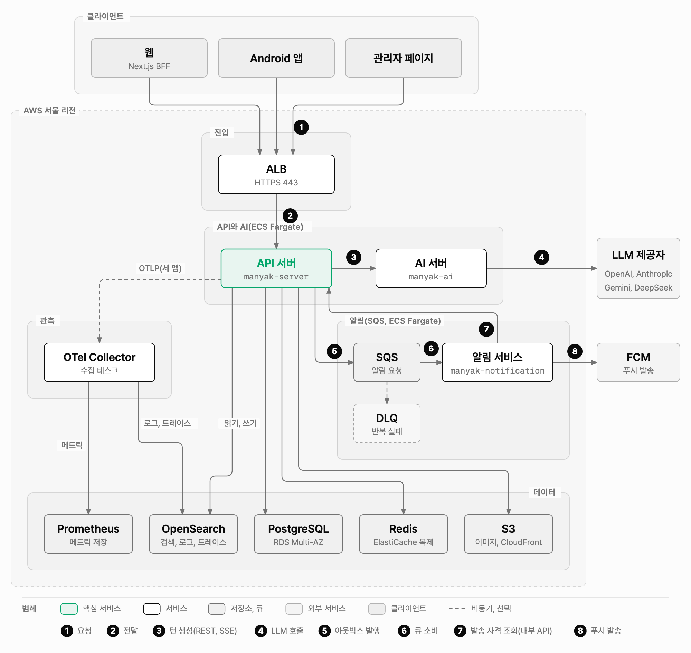
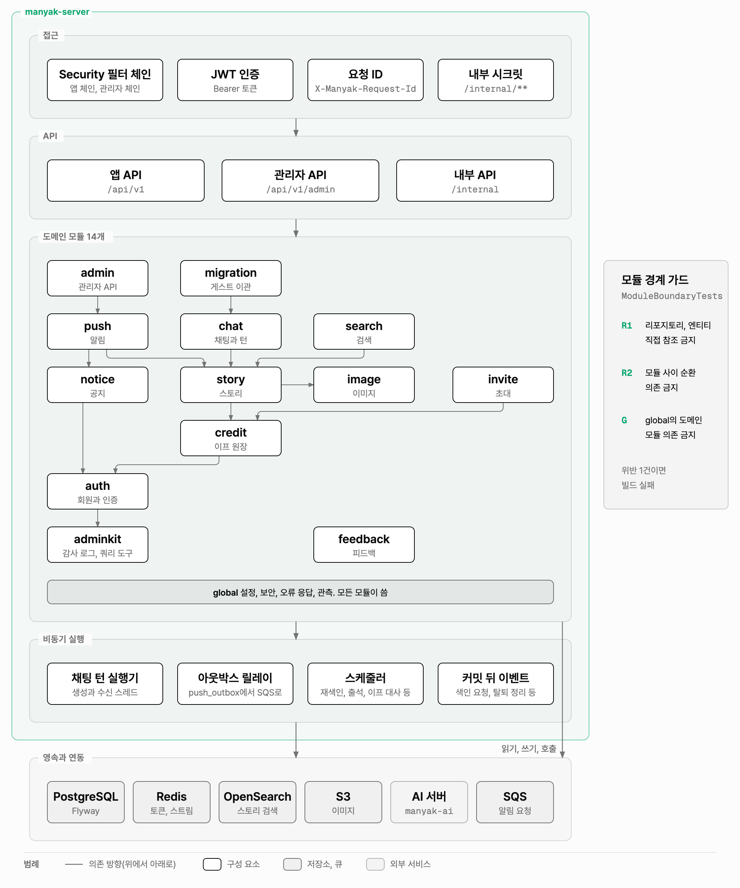
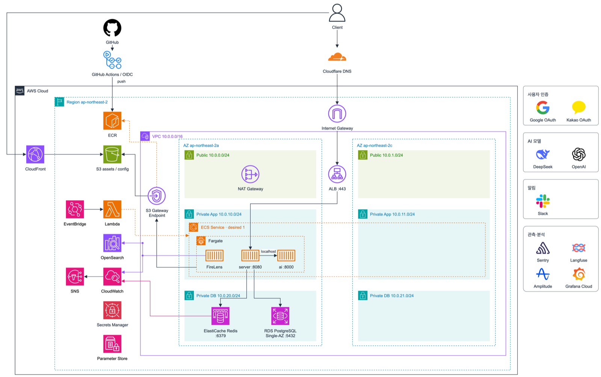
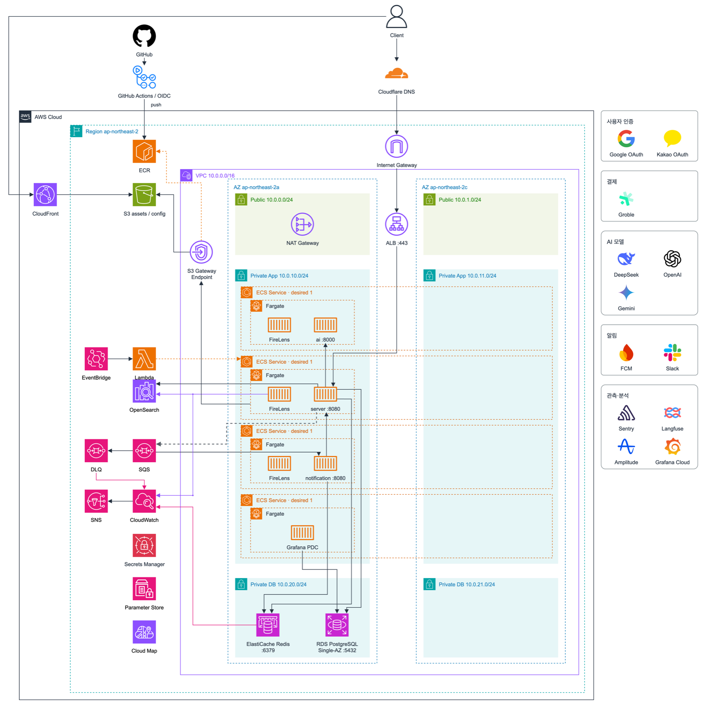
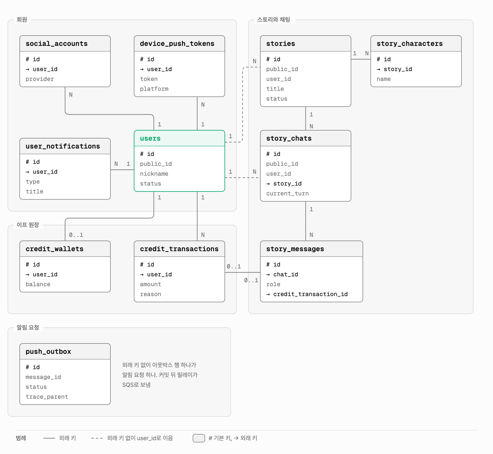
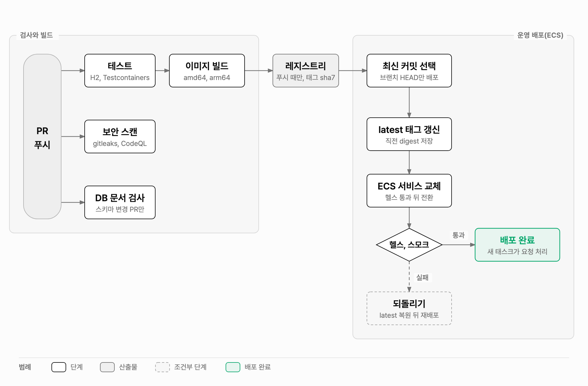
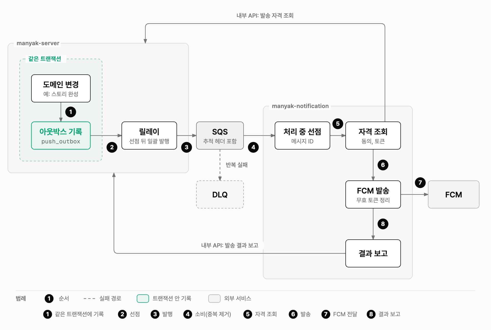
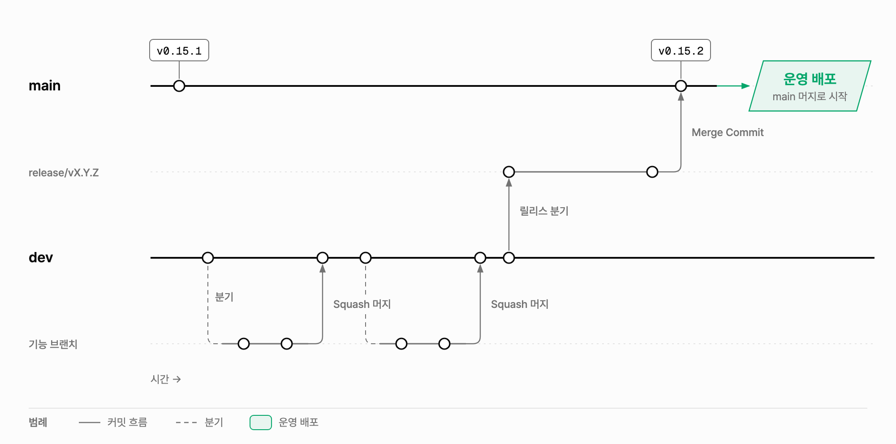

<div align="center">


# manyak-server

AI 스토리 채팅 서비스 **마냑**의 API 서버

</div>

## 목차

- [1. 프로젝트 개요](#1-프로젝트-개요)
  - [1-1. 프로젝트 소개](#1-1-프로젝트-소개)
  - [1-2. 시스템 구성도](#1-2-시스템-구성도)
  - [1-3. 주요 기능](#1-3-주요-기능)
  - [1-4. 개발 환경](#1-4-개발-환경)
- [2. 개발 결과물](#2-개발-결과물)
  - [2-1. 백엔드 아키텍처](#2-1-백엔드-아키텍처)
  - [2-2. 인프라 아키텍처](#2-2-인프라-아키텍처)
  - [2-3. 데이터베이스 ERD와 마이그레이션](#2-3-데이터베이스-erd와-마이그레이션)
  - [2-4. API 문서화와 수동 검증](#2-4-api-문서화와-수동-검증)
  - [2-5. 테스트](#2-5-테스트)
  - [2-6. 리팩터링](#2-6-리팩터링)
  - [2-7. CI/CD 파이프라인](#2-7-cicd-파이프라인)
  - [2-8. 채팅 턴 스트리밍](#2-8-채팅-턴-스트리밍)
  - [2-9. 알림 파이프라인](#2-9-알림-파이프라인)
  - [2-10. 검색](#2-10-검색)
  - [2-11. 이미지 업로드](#2-11-이미지-업로드)
  - [2-12. 관측과 장애 진단](#2-12-관측과-장애-진단)
  - [2-13. 부하 테스트](#2-13-부하-테스트)
  - [2-14. 비용 최적화](#2-14-비용-최적화)
- [3. 수행 방법](#3-수행-방법)
  - [3-1. 스펙 주도 개발](#3-1-스펙-주도-개발)
  - [3-2. 형상 관리와 릴리스](#3-2-형상-관리와-릴리스)
  - [3-3. AI 에이전트 협업](#3-3-ai-에이전트-협업)
- [4. 개발 가이드](#4-개발-가이드)

## 1. 프로젝트 개요

### 1-1. 프로젝트 소개

마냑은 사용자가 고른 키워드로 AI가 스토리를 만드는 서비스입니다. 사용자는 그 스토리 속 인물과 채팅하며 이야기를 이어 갑니다. 서비스 주소는 <https://www.manyak.app>입니다.

이 레포는 마냑의 API 서버입니다. 회원과 인증, 스토리 제작과 탐색, 채팅 턴 생성, 재화(이프) 결제, 알림, 관리자 기능을 맡습니다. AI•SW 마에스트로 17기 김앤강 팀이 2026년 6월부터 개발했습니다.

| 레포 | 역할 |
| --- | --- |
| [knk-harness](https://github.com/KIM-N-KANG/knk-harness) | 도메인 스펙과 팀 공용 LLM 작업 하네스 |
| [manyak-ai](https://github.com/KIM-N-KANG/manyak-ai) | 스토리와 채팅 턴을 생성하는 AI 서버(Python, FastAPI) |
| [manyak-notification](https://github.com/KIM-N-KANG/manyak-notification) | 푸시를 보내는 알림 서비스(Kotlin, Spring Boot) |
| [manyak-web](https://github.com/KIM-N-KANG/manyak-web) | 웹 클라이언트와 BFF(Next.js) |
| [manyak-android](https://github.com/KIM-N-KANG/manyak-android) | Android 앱 |
| [manyak-admin](https://github.com/KIM-N-KANG/manyak-admin) | 관리자 페이지 |

### 1-2. 시스템 구성도



서버는 요청마다 요청 ID를 붙이고, AI 서버와 알림 서비스에도 같은 ID와 추적 정보를 넘겨 한 요청의 흐름을 서비스 사이에서 이어 봅니다.

### 1-3. 주요 기능

<table>
  <tr>
    <td align="center"></td>
    <td align="center"></td>
    <td align="center"></td>
    <td align="center"></td>
    <td align="center"></td>
  </tr>
  <tr>
    <td align="center">간편 제작: 장르</td>
    <td align="center">간편 제작: 주인공</td>
    <td align="center">간편 제작: 이미지 스타일</td>
    <td align="center">채팅 선택지</td>
    <td align="center">실시간 이미지</td>
  </tr>
</table>

- **스토리 제작**: 장르, 주인공, 주변 인물을 키워드로 고르면 AI가 스토리라인 세 개를 제안하고, 하나를 고르면 스토리가 완성됩니다.
- **채팅**: 스토리 속 인물과 턴 단위로 대화합니다. 응답 다시 만들기, 선택지, 실시간 이미지, 특정 턴에서 새 채팅으로 갈라지기를 지원합니다.
- **탐색과 알림**: 홈 섹션, 공개 목록, 검색과 푸시 알림을 제공합니다.
- **이프와 관리자**: 턴과 이미지 생성에 재화인 이프를 쓰고, 관리자 API로 검수와 운영 지표를 관리합니다.

### 1-4. 개발 환경

- **서버**: Kotlin 2.2.21, Spring Boot 4.0.6, Java 21, Gradle 9.5.1
- **저장소**: PostgreSQL 16과 Flyway, Redis 7, OpenSearch(nori)
- **테스트와 문서**: JUnit 5, Testcontainers, ArchUnit, springdoc-openapi, tbls
- **관측**: OpenTelemetry, Sentry

## 2. 개발 결과물

### 2-1. 백엔드 아키텍처



서버는 하나의 애플리케이션을 모듈 14개로 나눈 구조(모듈러 모놀리스)입니다. 다른 모듈의 리포지토리나 엔티티를 직접 참조하거나 모듈끼리 순환하면 모듈 경계 테스트(ArchUnit)가 빌드를 실패시킵니다. 회원, 스토리, 채팅의 식별자는 UUID이고, 오류 응답은 `code`, `message`, `details` 필드로 맞췄습니다.

### 2-2. 인프라 아키텍처

> 아래 구성은 최종 발표(2026년 11월 14일) 기준입니다.


Ver.5까지는 트레이스와 지표를 서로 다른 경로로 보냈고, Ver.6에서 OTel Collector 하나로 모았습니다.

<details>
<summary><b>Ver.1 ~ Ver.5 발전 과정</b></summary>

<br>

**1) Ver.1 첫 운영과 계층 분리**


EC2 한 대의 Docker Compose에서 server와 ai를 실행하고 퍼블릭, 앱, 데이터 서브넷을 나눴습니다. RDS와 Redis는 처음부터 관리형으로 두었습니다.

**2) Ver.2 컨테이너 운영 전환**



배포 중에 서비스가 잠시 멈췄습니다. RDS 비밀번호가 바뀌어도 EC2 설정은 그대로라 DB 인증에 실패한 일도 있었습니다. Compose 구성을 ECS 태스크로 옮기고 EC2는 회수했습니다.

**3) Ver.3 서비스 분리**



푸시 발송이 실패하면 다시 보내지 않았습니다. 발송을 SQS와 별도 알림 서비스로 나누고, AI 서버도 혼자 배포할 수 있게 했습니다.

**4) Ver.4 이중화 계획**


RDS, Redis, NAT가 모두 한 가용 영역에 있어 그 영역에 장애가 나면 서비스도 멈출 수 있었습니다. 두 가용 영역에 나누는 계획안입니다.

**5) Ver.5 분산 추적과 이중화 적용**


요청 ID만으로는 채팅 턴 처리가 어디서 멈췄는지 찾지 못했습니다. Data Prepper로 세 앱의 트레이스를 모으고, Ver.4의 이중화를 적용했습니다.

</details>

### 2-3. 데이터베이스 ERD와 마이그레이션



전체 테이블 64개 가운데 핵심 11개의 관계를 보여 줍니다. 도메인별로는 스토리 30개, 채팅 9개, 이프와 결제 7개, 알림 6개, 회원과 인증 5개, 관리자 4개, 그 밖 3개입니다. 스키마 문서는 [tbls](https://github.com/k1LoW/tbls)로 실제 DB에서 만들고, CI는 마이그레이션으로 만든 DB와 문서가 다르면 PR을 막습니다. 전체 ERD는 [dbdoc](dbdoc/README.md)에 있습니다.

### 2-4. API 문서화와 수동 검증

API 183개(앱 93개, 관리자 90개)의 OpenAPI 명세는 springdoc이 코드에서 만들고, 관리자 웹은 이 명세로 요청 타입을 생성합니다. 엔드포인트를 바꾸면 통합 테스트와 함께 [`http/`](http) 아래 수동 검증 파일(84개)을 고칩니다.

### 2-5. 테스트

전체 테스트 3,971개가 모두 통과합니다(2026-11-21 실행). 하네스 스펙의 테스트 케이스 표를 기준으로, 행마다 입력과 기대 결과를 테스트로 옮깁니다. 대부분 컨트롤러부터 DB 저장까지 확인하는 통합 테스트이고, PostgreSQL과 OpenSearch 동작은 Testcontainers로 확인합니다.

JaCoCo로 잰 커버리지는 라인 96.7%, 분기 83.3%입니다(2026-11-21 측정). 통합 테스트끼리 Spring 컨텍스트를 함께 쓰고 테스트 안의 대기 시간을 줄여, 전체 실행 시간을 496초에서 196초로 줄였습니다([#480](https://github.com/KIM-N-KANG/manyak-server/pull/480), [#481](https://github.com/KIM-N-KANG/manyak-server/pull/481)).

### 2-6. 리팩터링

모듈 경계 위반을 세는 테스트를 먼저 넣고, 위반이 늘지 않게 막은 채 하나씩 줄였습니다. 다른 모듈의 리포지토리와 엔티티를 참조하던 268곳, 모듈 사이 순환 47건, `global`의 도메인 의존 22건을 모두 없앴습니다([#482](https://github.com/KIM-N-KANG/manyak-server/pull/482) 기준선, [#539](https://github.com/KIM-N-KANG/manyak-server/pull/539) 마지막 정리). 이제 위반이 하나라도 생기면 빌드가 실패합니다.

<details>
<summary><b>리팩터링 예: 의존 방향 뒤집기</b></summary>

<br>

story 모듈이 누적 턴 수를 세려고 chat 모듈의 리포지토리를 직접 불렀습니다. story가 인터페이스를 정의하고 chat이 구현하게 바꿔 `story → chat` 의존을 없앴습니다. 동작은 그대로입니다([#484](https://github.com/KIM-N-KANG/manyak-server/pull/484)).

**변경 전**

```kotlin
// story/service/StoryService.kt
import com.knk.manyak.chat.repository.StoryChatRepository

turnCount = storyChatRepository.sumTurnCountByStoryId(story.id),
```

**변경 후**

```kotlin
// story/service/StoryTurnCounts.kt
interface StoryTurnCounts {
    fun countByStoryId(storyId: Long): Long
    // 여러 스토리를 한 번에 세는 메서드는 생략
}

// chat/service/ChatStoryTurnCounts.kt
@Component
class ChatStoryTurnCounts(private val storyChatRepository: StoryChatRepository) : StoryTurnCounts {
    // chat의 리포지토리로 세는 구현은 생략
}

// story/service/StoryService.kt
turnCount = storyTurnCounts.countByStoryId(story.id),
```

</details>

### 2-7. CI/CD 파이프라인



배포 잡은 늦게 끝난 옛 빌드가 최신 배포를 덮지 않도록 main의 최신 커밋만 배포합니다.

### 2-8. 채팅 턴 스트리밍


생성 작업과 전달 연결을 나눠, 앱을 닫았다 열어도 새 AI 호출 없이 생성 중인 턴을 이어 받습니다. 턴을 저장하지 못하면 먼저 차감한 이프를 돌려줍니다.

### 2-9. 알림 파이프라인



발송 요청을 도메인 변경과 같은 트랜잭션에 기록하므로, 커밋 직후 서버가 멈춰도 알림이 사라지지 않습니다.

### 2-10. 검색


제목, 한 줄 소개, 장르, 인물 이름을 nori 분석기로 색인합니다. 결과를 DB에서 다시 확인해, 비공개로 바뀐 스토리는 나오지 않습니다.

### 2-11. 이미지 업로드


이미지는 서버의 메모리와 대역폭을 쓰지 않도록 클라이언트가 S3에 바로 올립니다. 이미지가 여러 장인 제출은 S3 확인 요청을 동시에 보내 접수 시간을 2,205\~2,563ms에서 304\~541ms로 줄였습니다([#544](https://github.com/KIM-N-KANG/manyak-server/pull/544)).

### 2-12. 관측과 장애 진단


로그에 요청 ID와 트레이스 ID가 함께 남아, 로그 한 줄에서 서버, AI, 알림 서비스까지 이어진 트레이스로 넘어갑니다. 오류는 Sentry, LLM 호출과 비용은 Langfuse, 사용자 행동은 Amplitude로 봅니다.

**진단 에이전트**는 지표가 기준을 넘어 이상 징후가 잡히면 3분 동안 신호를 더 모은 뒤, LLM이 읽기 전용 도구로 트레이스, 로그, 메트릭을 조회해 원인을 진단하고 Slack에 보고합니다. 부하 테스트에서 찾은 병목 4건의 장애 구간을 두 번씩 진단하게 한 평가에서 3건의 원인을 두 번 모두 맞혔습니다. 진단 한 건의 비용은 $0.1\~0.3입니다.


### 2-13. 부하 테스트

운영과 같은 사양의 별도 환경에 운영 DB 스냅샷을 복원해 채팅 부하를 측정했습니다(2026-10-08 \~ 11-03). LLM 자리에는 응답에 10.4초 걸리는 모의 서버를 두었습니다.

| 병목 | 수정 | 결과 |
| --- | --- | --- |
| 채팅 턴 실행기가 턴을 4개씩만 동시에 실행 | 동시 실행 수를 64로(v0.7.3, 운영 반영) | 수용 인원 25명 → 약 390명<br>100명 턴 p95 70초 → 10.6초 |
| 400명에서 동시 턴 상한 64 도달 | 상한 128(부하 환경에서 검증) | 실패율 1.9% → 0.4% |
| 500명에서 AI 서버 CPU가 확장 기준 70%에 못 미침 | 기준 50%(부하 환경에서 검증) | AI 턴 p95 13\~16초 → 12.0\~12.5초 |
| 목록 집계 쿼리로 DB CPU 포화 | 턴 수를 따로 저장하는 방식으로 바꿀 예정 | 채팅 6.5만 행에서 RDS CPU 96\~99% |

### 2-14. 비용 최적화

이중화는 그대로 두고 서비스별 7일 사용량에 맞춰 AWS 비용을 줄였습니다. 예를 들어 server는 CPU 사용률 p95가 40.5%라 1 vCPU에서 0.5 vCPU로 낮췄습니다. server와 ai는 온디맨드 태스크 하나에 Fargate Spot을 더하고, notification과 진단 에이전트는 Spot으로 실행합니다. 앱 태스크와 RDS, Redis는 Graviton(ARM64)으로 옮겼습니다.

| 항목 | 줄이기 전(11/02\~11/09 평균) | 줄인 뒤(11/11\~11/15 평균) |
| --- | --- | --- |
| 하루 평균(USD) | 18.75 | 13.30(29% 감소) |
| 30일 환산(USD) | 약 560 | 약 400 |

두 기간 모두 가용 영역 두 곳, Multi-AZ RDS, Redis 복제를 유지했습니다. 금액은 청구 상세의 기간 평균이고 부가가치세는 뺐습니다.

## 3. 수행 방법

### 3-1. 스펙 주도 개발

기능은 [knk-harness](https://github.com/KIM-N-KANG/knk-harness)의 도메인 스펙에서 시작합니다. 8개 도메인마다 요구사항, 구조, DB 스키마, API 계약, 테스트 케이스 문서가 있습니다. 코드와 스펙이 다르면 코드를 스펙에 맞추고, 설계를 바꿀 때는 스펙부터 고칩니다.

### 3-2. 형상 관리와 릴리스



기능 브랜치는 `dev`에 Squash로 머지합니다. `dev`에서 만든 `release/vX.Y.Z`는 `main`에 Merge Commit으로 머지하고 태그를 붙이며, `main`에 머지하면 운영 배포가 시작됩니다. `dev`에 아직 내보내면 안 되는 변경이 있는데 운영 수정이 급할 때만 `main`에서 `hotfix/` 브랜치를 만들고, 아직 쓴 적은 없습니다.

브랜치 이름, 커밋 메시지, PR 제목에 Jira 티켓 키를 넣고, PR은 템플릿(요약, 관련 이슈, 검증, API 변경, 체크리스트)에 맞춰 씁니다. 11개 레포의 머지된 PR 2,218개 제목에 모두 Jira 키가 있고, 완료 티켓의 86%에 연결된 PR이 있습니다. 서버는 78회 릴리스했고 간격의 중앙값은 0.9일입니다(2026-11-21 기준).

### 3-3. AI 에이전트 협업

계획과 검수를 맡는 AI 에이전트가 작업 지시서를 쓰고, 구현 에이전트가 브랜치를 만들고 테스트와 PR까지 맡습니다. 두 에이전트 모두 하네스의 규칙과 작업 절차를 따르고, 머지와 운영 릴리스는 사람이 승인합니다.

## 4. 개발 가이드

로컬 실행, 환경 변수, 엔드포인트, 스키마 문서 생성 방법은 [docs/DEVELOPMENT.md](docs/DEVELOPMENT.md)에 있습니다.
