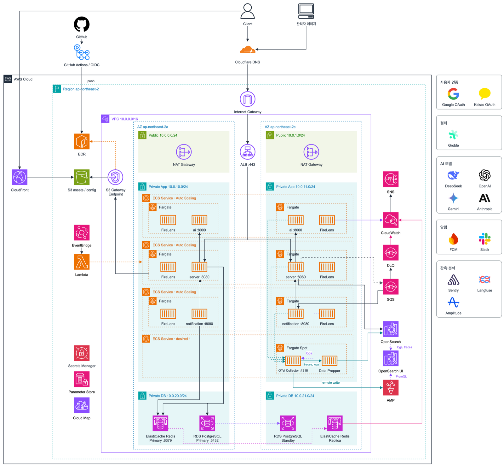
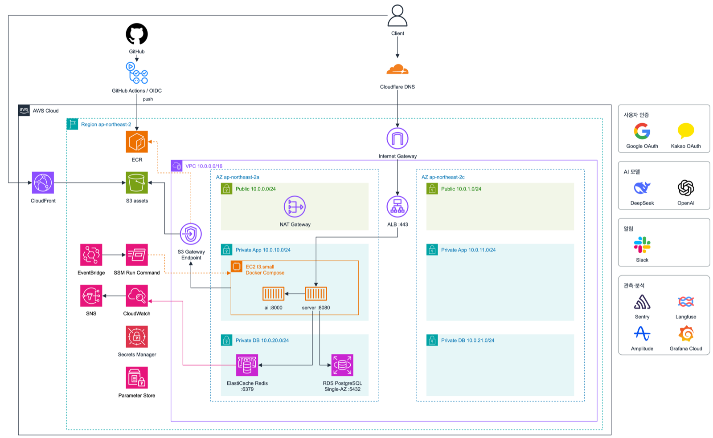

<div align="center">


# manyak-server

AI 스토리 채팅 서비스 **마냑**의 API 서버

</div>

## 목차

- [1. 프로젝트 개요](#1-프로젝트-개요)
  - [1-1. 프로젝트 소개](#1-1-프로젝트-소개)
  - [1-2. 시스템 구성도](#1-2-시스템-구성도)
  - [1-3. 주요 기능](#1-3-주요-기능)
  - [1-4. 개발 환경](#1-4-개발-환경)
- [2. 개발 결과물](#2-개발-결과물)
  - [2-1. 백엔드 아키텍처](#2-1-백엔드-아키텍처)
  - [2-2. 인프라 아키텍처](#2-2-인프라-아키텍처)
  - [2-3. 데이터베이스 ERD와 마이그레이션](#2-3-데이터베이스-erd와-마이그레이션)
  - [2-4. API 문서화와 수동 검증](#2-4-api-문서화와-수동-검증)
  - [2-5. 테스트](#2-5-테스트)
  - [2-6. 리팩터링](#2-6-리팩터링)
  - [2-7. CI/CD 파이프라인](#2-7-cicd-파이프라인)
  - [2-8. 채팅 턴 스트리밍](#2-8-채팅-턴-스트리밍)
  - [2-9. 알림 파이프라인](#2-9-알림-파이프라인)
  - [2-10. 검색](#2-10-검색)
  - [2-11. 이미지 업로드](#2-11-이미지-업로드)
  - [2-12. 관측과 장애 진단](#2-12-관측과-장애-진단)
  - [2-13. 부하 테스트](#2-13-부하-테스트)
  - [2-14. 비용 최적화](#2-14-비용-최적화)
- [3. 수행 방법](#3-수행-방법)
  - [3-1. 스펙 주도 개발](#3-1-스펙-주도-개발)
  - [3-2. 형상 관리와 릴리스](#3-2-형상-관리와-릴리스)
  - [3-3. AI 에이전트 협업](#3-3-ai-에이전트-협업)
- [4. 개발 가이드](#4-개발-가이드)

## 1. 프로젝트 개요

### 1-1. 프로젝트 소개

마냑은 사용자가 고른 키워드로 AI가 스토리를 만드는 서비스입니다. 사용자는 그 스토리 속 인물과 채팅하며 이야기를 이어 갑니다. 서비스 주소는 <https://www.manyak.app>입니다.

이 레포는 마냑의 API 서버입니다. 회원과 인증, 스토리 제작과 탐색, 채팅 턴 생성, 재화(이프) 결제, 알림, 관리자 기능을 맡습니다. AI•SW 마에스트로 17기 김앤강 팀이 2026년 6월부터 개발했습니다.

관련 공개 레포는 다음과 같습니다.

| 레포 | 역할 |
| --- | --- |
| [knk-harness](https://github.com/KIM-N-KANG/knk-harness) | 도메인 스펙과 팀 공용 LLM 작업 하네스 |
| [manyak-ai](https://github.com/KIM-N-KANG/manyak-ai) | 스토리 생성, 채팅 턴 생성, 검수 AI 서버(Python, FastAPI) |
| [manyak-notification](https://github.com/KIM-N-KANG/manyak-notification) | 큐 소비와 푸시 발송 알림 서비스(Kotlin, Spring Boot) |
| [manyak-web](https://github.com/KIM-N-KANG/manyak-web) | 웹 클라이언트와 BFF(Next.js) |
| [manyak-android](https://github.com/KIM-N-KANG/manyak-android) | Android 앱 |
| [manyak-admin](https://github.com/KIM-N-KANG/manyak-admin) | 관리자 페이지 |

### 1-2. 시스템 구성도


서버는 요청마다 요청 ID를 붙입니다. AI 서버와 알림 서비스도 같은 요청 ID와 트레이스를 이어 받습니다.

### 1-3. 주요 기능

<table>
  <tr>
    <td align="center"></td>
    <td align="center"></td>
    <td align="center"></td>
    <td align="center"></td>
    <td align="center"></td>
  </tr>
  <tr>
    <td align="center">간편 제작: 장르</td>
    <td align="center">간편 제작: 주인공</td>
    <td align="center">간편 제작: 이미지 스타일</td>
    <td align="center">채팅 선택지</td>
    <td align="center">실시간 이미지</td>
  </tr>
</table>

- **스토리 제작**: 장르, 주인공, 주변 인물을 키워드로 고르면 AI가 스토리라인 세 개를 제안합니다. 그중 하나를 고르면 스토리가 완성됩니다. 직접 쓰는 일반 제작도 있습니다.
- **채팅**: 스토리 속 인물과 턴 단위로 대화합니다. 응답은 SSE로 보냅니다. 재생성, 선택지, 실시간 이미지, 입력 수정, 포크, 공유를 지원합니다.
- **탐색과 검색**: 홈 섹션, 공개 목록, 제목과 인물 이름 검색을 제공합니다.
- **이프와 결제**: 턴과 이미지 생성에는 재화 이프를 씁니다. 체험 이프와 결제 충전은 원장으로 관리합니다.
- **알림**: 스토리 완성, 검수 결과, 출석, 캠페인 푸시와 알림함을 제공합니다.
- **관리자**: 관리자 API로 운영 지표, 검수와 공개 중단, 캠페인, 이프 조정을 제공합니다.

### 1-4. 개발 환경

| 항목 | 버전 |
| --- | --- |
| Kotlin | 2.3.21 |
| Spring Boot | 4.1.2(Web MVC, Data JPA, Security, Actuator) |
| Java | 25 |
| Gradle | 9.5.1 |
| PostgreSQL | 16(로컬 기준), Flyway |
| Redis | 7 |
| OpenSearch | 클라이언트 3.10.0, nori 분석기 |
| 테스트 | JUnit 5, AssertJ, Testcontainers 2.0.3, ArchUnit 1.5.1 |
| 문서 | springdoc-openapi 3.0.3, tbls |
| 관측 | Spring Boot OpenTelemetry, Sentry |

## 2. 개발 결과물

### 2-1. 백엔드 아키텍처

서버는 모듈러 모놀리스입니다. `com.knk.manyak` 아래 최상위 패키지 하나가 모듈 하나입니다. 모듈은 14개입니다. 그림의 모듈 사이 화살표는 실제 코드 의존을 줄여 그린 것입니다.


모듈 경계는 ArchUnit 테스트(`ModuleBoundaryTests`)가 검사합니다. 위반이 하나라도 생기면 빌드가 실패합니다. 실패 메시지에는 위반한 클래스 쌍이 나옵니다.

| 규칙 | 내용 |
| --- | --- |
| R1 | 다른 모듈의 리포지토리와 엔티티 직접 참조 금지<br>그 모듈의 조회 서비스, 잠금 진입점, 명령을 호출함 |
| R2 | 모듈 사이 순환 금지<br>아래 모듈이 위 모듈을 알아야 하면 인터페이스나 이벤트를 아래 모듈에 둠 |
| G | `global`의 도메인 모듈 의존 금지 |

회원, 스토리, 채팅, 인물처럼 주소로 가리키는 리소스의 식별자는 UUID(`public_id`)입니다. 턴, 태그, 장르처럼 그 안에서 쓰는 항목은 숫자 ID를 씁니다. 오류 응답은 `code`, `message`, `details` 형태로 맞췄습니다.

### 2-2. 인프라 아키텍처

> 아래 구성은 최종 발표(2026년 11월 14일) 기준입니다.



Ver.6은 두 가용 영역에 걸친 이중화 구성입니다.

- **앱**: server, ai, notification을 각각 ECS Fargate 서비스로 두고 서비스마다 오토스케일링합니다. notification은 Cloud Map 주소로 서버의 내부 API를 호출합니다. 공개 ALB는 내부 경로를 막습니다.
- **데이터**: RDS PostgreSQL은 Multi-AZ, ElastiCache Redis는 Primary와 Replica입니다. 가용 영역마다 NAT Gateway를 둡니다.
- **관측**: 세 앱의 OTLP를 OTel Collector가 받아 로그와 트레이스는 OpenSearch로, 메트릭은 Prometheus로 보냅니다.
- **배포**: 레포별 GitHub OIDC 역할로 ECR에 이미지를 올리고 ECS 서비스를 교체합니다.

<details>
<summary><b>Ver.1 ~ Ver.5 발전 과정</b></summary>

<br>

**1) Ver.1 첫 운영과 계층 분리**



Ver.1은 첫 운영과 계층 분리에 중점을 두었습니다. EC2 한 대의 Docker Compose에서 server와 ai를 실행하고 퍼블릭, 앱, 데이터 서브넷을 나눴습니다. RDS PostgreSQL과 Redis는 처음부터 관리형 서비스로 두었습니다.

**2) Ver.2 컨테이너 운영 전환**


Ver.2는 컨테이너 운영 전환에 중점을 두었습니다. Docker Compose 구성을 ECS 태스크 하나로 옮기고 컨테이너 로그를 FireLens로 OpenSearch에 모았습니다. 전환을 마친 뒤 EC2는 회수했습니다.

**3) Ver.3 서비스 분리**


Ver.3은 서비스 분리에 중점을 두었습니다. 푸시 발송을 독립 알림 서비스로 떼어 내고 SQS, DLQ, Cloud Map을 더했습니다. 스토리 검색용 OpenSearch 색인(nori)도 이때 넣었습니다.

**4) Ver.4 이중화 계획**


Ver.4는 가용성 이중화에 중점을 둔 계획안입니다. 세 앱을 두 가용 영역에 나누고 RDS Multi-AZ, Redis 복제, 가용 영역별 NAT를 두는 안을 그렸습니다. 이 계획은 Ver.5에서 적용했습니다.

**5) Ver.5 분산 추적과 이중화 적용**


Ver.5는 분산 추적과 이중화 적용에 중점을 두었습니다. Data Prepper로 세 앱의 트레이스를 모아 OpenSearch에서 서비스 맵을 볼 수 있게 했습니다. 서비스마다 태스크를 최소 2개, 최대 4개로 늘리고 RDS Multi-AZ와 Redis 자동 장애 조치를 켰습니다.

</details>

<details>
<summary><b>Ver.1 ~ Ver.6 버전별 계기</b></summary>

<br>

날짜는 KST입니다. 결정 번호 DEP는 하네스 [배포 결정 기록](https://github.com/KIM-N-KANG/knk-harness/blob/dev/docs/operations/DECISIONS.md), BE는 하네스 [백엔드 결정 기록](https://github.com/KIM-N-KANG/knk-harness/blob/dev/docs/reference/decisions/BACKEND.md)의 번호입니다. 인프라 코드는 비공개 레포에 있어 PR 링크를 달지 않았습니다.

| 버전 | 기간 | 계기 |
| --- | --- | --- |
| Ver.1 | 6/24~8/23 | 첫 AWS 배포 |
| Ver.2 | 8/14~8/25 | 무중단 배포와 배포 경로 단순화<br>DB 비밀번호 회전 장애 |
| Ver.3 | 9/7~10/6 | 커밋 뒤 푸시 발송 실패가 재시도 없이 사라짐<br>AI를 따로 배포할 필요 |
| Ver.4 | 10/2~10/7 | 데이터 계층이 한 가용 영역에 몰림 |
| Ver.5 | 10/2~10/10 | 이중화 계획 실행<br>10/6 채팅 턴 워커 정지 구간을 특정하지 못함 |
| Ver.6 | 10/23~11/10 | 지표와 트레이스 경로를 하나로 모음 |

**1) Ver.1**

2026-06-24~25에 첫 AWS 배포로 만들었습니다. 이때 이미 그림을 지금(EC2와 Compose)과 목표(ECS Fargate, 두 가용 영역, OIDC)로 나눠 두었습니다(DEP-001).

운영 중 7월 2일에 DB 인증 장애가 났습니다. RDS가 7일마다 비밀번호를 바꾸는데, EC2의 `.env`는 부팅할 때 한 번만 채워졌기 때문입니다. EventBridge가 5분마다 비밀번호가 바뀌었는지 확인하고, SSM으로 배포 스크립트를 다시 실행해 EC2의 `.env`를 새 값으로 바꾸게 했습니다(DEP-003). 시크릿을 검증한 뒤 한 번에 바꾸는 방식(DEP-013)과 AI 모델 설정의 외부화(DEP-016)도 이 시기에 정했습니다.

**2) Ver.2**

ECS 전환의 목적은 비용이 아니라 무중단 배포와 배포 경로 단순화였습니다. 태스크가 뜰 때마다 Secrets Manager에서 값을 다시 읽으므로 Ver.1의 회전 동기화 장치도 필요 없어집니다. dev를 먼저 ECS로 옮겨(8/14) 클라이언트가 늘 붙을 수 있는 개발 API를 두고, Fargate 문제를 운영에서 처음 겪지 않게 했습니다(DEP-017).

| 정한 것 | 내용 |
| --- | --- |
| 전환 방식 | ALB 리스너 가중치를 0 → 10 → 100으로 옮김<br>100% 뒤 요청 20건 모두 200, 오류 로그 0건 |
| 데이터 이전 분리 | 계산 자원만 옮기고 RDS와 ElastiCache는 그대로 둠(DEP-023) |
| Spot 미사용 | 운영 태스크가 하나라 회수가 곧 장애 |
| OpenSearch 공유 | 도메인 하나를 환경별 인덱스로 나눠 씀. 환경마다 드는 고정 비용을 줄임(DEP-020) |
| 회전 대응 | Lambda가 5분마다 비밀번호 변경 시각과 태스크 시작 시각을 비교해 필요하면 재배포(DEP-029) |

전환 작업 중 머지하지 않은 브랜치로 공유 상태에 apply해 dev 로그 설정이 지워진 사고가 있었습니다. 그 뒤 "머지한 코드만 apply" 규칙, 삭제 방어(DEP-025), PR 검증과 drift 감지 CI(DEP-026)를 더했습니다.

**3) Ver.3**

알림 분리는 2026-09-18 멘토링에서 정했습니다(BE-047). 당시 커밋 뒤 FCM 발송이 실패하면 로그만 남고 재시도가 없었습니다. 검색 색인은 원본 데이터에서 다시 만들 수 있지만 푸시는 그럴 수 없습니다. 그래서 푸시에 아웃박스와 중복 없는 소비를 먼저 넣기로 했습니다. 운영은 SQS, 로컬은 Kafka로 정했습니다.

AI 서버는 server 태스크의 사이드카에서 떼어 독립 서비스로 만들었습니다. 따로 배포하기 위해서이고, 이중화로 server 태스크를 늘릴 때 AI 컨테이너까지 함께 늘지 않게 하려는 것입니다.

| 정한 것 | 내용 |
| --- | --- |
| 서버 내부 API 호출 경로 | Cloud Map(TTL 10초)<br>공개 ALB와 NAT 주소 규칙은 Cloudflare 프록시를 켜면 조용히 깨져서, 내부 ALB는 월 16달러 이상이라 기각(BE-051) |
| SQS | 가시성 60초, 5회 실패 뒤 DLQ, DLQ 14일 보관<br>DLQ에 메시지가 하나라도 있으면 경보 |
| 공개 ALB | `/internal/*`에 404 |
| 검색 | 새 도메인 없이 공유 도메인에 환경별 스토리 인덱스(DEP-039, DEP-040) |

**4) Ver.4**

운영은 태스크 1개, RDS 단일 AZ, Redis 단일 노드, NAT 1개였습니다. 데이터 계층이 모두 한 가용 영역에 있어 그 영역에 장애가 나면 복구될 때까지 서비스도 멈춥니다. MVP 단계에서는 트래픽에 비해 비용이 커서 미뤄 둔 것입니다. EC2 Auto Scaling group, 태스크별 Redis, 이중화를 더 미루는 안을 비교한 뒤 이 계획을 세웠습니다. 순서는 두 번째 NAT → RDS Multi-AZ → 태스크 2개 → Redis 복제 → 오토스케일링 2~4개입니다.

**5) Ver.5**

이중화는 10월 2일에 계획 순서대로 켰습니다. 태스크가 최대 4개로 늘면 DB 연결도 늘어서 연결 상한부터 계산했습니다. 지난 7일 RDS 연결은 평균 10, 최대 30이었고 db.t3.micro의 최대 연결은 약 80입니다. 그래서 태스크당 연결 풀을 10에서 5로 줄였습니다. 배포 중 태스크가 겹쳐도 40을 넘지 않습니다. CPU 70% 확장 기준은 부하 테스트 전의 잠정값으로 두었습니다.

분산 추적은 10월 6일 운영 사건에서 시작했습니다. 채팅 턴 워커가 AI 호출 기록 전에 멈췄는데, 서비스 사이를 잇는 단서가 요청 헤더와 요청 ID뿐이라 멈춘 구간을 찾지 못했습니다(BE-056). 수집 방식은 비용을 보고 정했습니다. 관리형 수집(OSIS)은 최소 월 약 194달러, Fargate Spot에서 직접 돌리는 Data Prepper는 월 약 7~8달러입니다.

같은 시기에 부하 테스트 환경을 따로 만들었습니다. 운영 RDS와 Redis가 t3 계열이라 부하를 주면 CPU 크레딧이 바닥날 수 있기 때문입니다. ([2-13 부하 테스트](#2-13-부하-테스트))

**6) Ver.6**

서버 지표는 앱이 Grafana Cloud로 직접 보내고 있었습니다. 10월 23~24일에 지표도 트레이스와 같은 OTel Collector를 거치게 바꿨습니다. 옮긴 뒤 기존 Grafana 경보 규칙 3개가 데이터를 받지 못해 운영 경보가 비는 구간이 생겼고, 경보도 AMP로 옮겼습니다(10/30, DEP-047). 11월 초에는 진단 에이전트를 ECS 서비스로 올렸습니다.

11월 10일에는 이중화와 태스크 수, 오토스케일링 범위를 그대로 두고 사양만 줄여 비용을 낮췄습니다. ([2-14 비용 최적화](#2-14-비용-최적화))

</details>

### 2-3. 데이터베이스 ERD와 마이그레이션

테이블은 64개입니다. Flyway 마이그레이션은 125개(V1~V128)입니다. 아래 그림은 핵심 테이블 11개의 관계입니다.


핵심 밖 테이블까지 도메인별로 나누면 다음과 같습니다.

| 도메인 | 테이블 수 | 대표 테이블 |
| --- | --- | --- |
| 회원과 인증 | 5 | `users`, `social_accounts`, `user_consents`, `user_personas` |
| 스토리 | 30 | `stories`, `story_characters`, `story_creation_sessions`, `home_sections` |
| 채팅 | 9 | `story_chats`, `story_messages`, `story_choices`, `chat_models` |
| 이프와 결제 | 7 | `credit_wallets`, `credit_transactions`, `credit_lots`, `credit_orders` |
| 알림 | 6 | `push_outbox`, `push_campaigns`, `device_push_tokens`, `user_notifications` |
| 검수 | 1 | `story_submissions` |
| 공지 | 1 | `notices` |
| 관리자 | 4 | `admin_accounts`, `admin_audit_logs`, `admin_analytics_daily_values` |
| 그 밖 | 1 | `ai_call_logs` |
| 합계 | 64 | |

전체 ERD와 테이블별 컬럼은 [dbdoc](dbdoc/README.md)에 있습니다.

스키마 문서는 [tbls](https://github.com/k1LoW/tbls)로 실제 DB에서 자동 생성합니다. CI(`db-docs.yml`)는 마이그레이션을 실제 PostgreSQL에 적용해 문서와 비교합니다. 차이가 나면 PR이 통과하지 못합니다.

### 2-4. API 문서화와 수동 검증

API 오퍼레이션은 앱용 93개, 관리자용 90개로 모두 183개입니다. 명세는 springdoc이 코드에서 OpenAPI로 생성합니다. 관리자 웹은 이 명세에서 요청 타입을 생성해 씁니다. 내부 API(`/internal/**`)는 공유 시크릿으로 보호합니다. 공개 명세에는 내부 API를 넣지 않습니다.

엔드포인트를 추가하거나 계약을 바꾸면 통합 테스트와 함께 [`http/`](http) 아래 수동 검증 파일을 고칩니다. 지금 파일은 84개입니다. IntelliJ HTTP Client로 바로 실행할 수 있습니다. 파일은 헬스 체크, 준비 요청, 핵심 검증, 오류 케이스 순서로 이어집니다. 응답 핸들러에서 상태 코드와 필드를 단언합니다.

### 2-5. 테스트

전체 테스트는 3,971개이고 모두 통과합니다(2026-11-21 실행). 테스트의 기준은 하네스 스펙의 테스트 케이스 표입니다. 도메인마다 `5-5-TEST-CASES.md`에 확인 항목, 입력과 상황, 기대 결과를 행 단위로 적습니다. 테스트는 각 행의 입력과 기대 결과를 그대로 옮깁니다. 기준은 테스트 케이스 표의 행을 모두 테스트로 옮겼는지이고, 커버리지 수치는 함께 확인하는 값입니다.

기본 테스트 프로파일은 H2에서 컨트롤러부터 저장까지 통합 테스트로 확인합니다. 마이그레이션, PostgreSQL 전용 동작, 검색은 Testcontainers로 실제 PostgreSQL(16, 17)과 OpenSearch를 실행해 확인합니다. AI 서버는 테스트용 클라이언트로 바꿉니다. 분석 도구 같은 외부 API는 MockWebServer로 대신합니다.

JaCoCo 보고서 합계로 잰 커버리지는 라인 96.7%(17,398/17,993), 분기 83.3%(8,296/9,962)입니다(2026-11-21 측정). 테스트 대부분이 통합 테스트라 라인 커버리지가 높습니다. 가장 낮은 모듈은 `image`(라인 72.7%)입니다. S3 presign과 HEAD 검증이 실제 S3 없이 일부만 실행되기 때문입니다.

테스트 실행 시간은 두 번에 걸쳐 줄였습니다.

| PR | 한 일 | 결과 |
| --- | --- | --- |
| [#480](https://github.com/KIM-N-KANG/manyak-server/pull/480) | 공용 베이스 클래스로 통합 테스트의 Spring 컨텍스트 공유 | 컨텍스트 조합 106개 → 23개(78% 감소)<br>컨텍스트 기동 125회 → 23회(82% 감소)<br>전체 496초 → 367초(26% 감소) |
| [#481](https://github.com/KIM-N-KANG/manyak-server/pull/481) | 테스트 전용 재시도와 대기 단축<br>PostgreSQL 컨테이너는 JVM당 한 번 실행, 클래스마다 DB 복제 | 전체 369초 → 195초(47% 감소) |

### 2-6. 리팩터링

모듈 경계를 측정하는 테스트를 먼저 넣었습니다. 그다음 위반 수를 기준선으로 고정하고 하나씩 줄였습니다. 위반을 늘리는 변경은 테스트가 실패합니다. 위반을 줄인 변경은 기준선도 함께 낮춰야 통과합니다. 세 규칙 모두 0이 된 뒤에는 기준선을 없애고, 위반이 하나라도 있으면 실패하게 했습니다.

| 규칙 | 기준선([#482](https://github.com/KIM-N-KANG/manyak-server/pull/482)) | 최종([#539](https://github.com/KIM-N-KANG/manyak-server/pull/539)) |
| --- | --- | --- |
| R1 다른 모듈의 리포지토리, 엔티티 참조 | 268 | 0 |
| R2 모듈 간 순환 간선 | 47(간선 58개 중) | 0 |
| G `global`의 도메인 의존 | 22 | 0 |

코드를 옮길 때마다 기존 테스트를 먼저 통과시켰습니다. 조회 수와 응답이 전후로 같은지도 확인했습니다. 예를 들어 게스트 이관의 쿼리 수는 경계를 고친 뒤에도 18개 그대로입니다.

<details>
<summary><b>리팩터링 상세</b></summary>

<br>

기준은 2026-11-21까지 머지한 PR이고, 날짜는 KST입니다.

**1) 범주**

제목이 `Refactor`인 머지 PR은 64개입니다. 성능 개선은 `Perf` PR 12개로 따로 냈습니다.

| 범주 | PR 수 | 기간 | 예 |
| --- | --- | --- | --- |
| 이름과 계약 정렬 | 9 | 6/26~7/3 | [#80](https://github.com/KIM-N-KANG/manyak-server/pull/80) 분석 식별자 `anonymous_id` → `device_id`<br>[#93](https://github.com/KIM-N-KANG/manyak-server/pull/93) 플레이 세션 테이블 `chat` 명명 |
| 흐름과 설계 정리 | 6 | 7/6~9/1 | [#117](https://github.com/KIM-N-KANG/manyak-server/pull/117) 일반 제작 단발 등록 전환(-3,663줄)<br>[#166](https://github.com/KIM-N-KANG/manyak-server/pull/166) 계정 연동 프로토콜을 확정 설계로 정렬 |
| 안 쓰는 경로 제거 | 4 | 10/2~10/19 | [#333](https://github.com/KIM-N-KANG/manyak-server/pull/333) Google Play 결제 경로 제거<br>[#349](https://github.com/KIM-N-KANG/manyak-server/pull/349) 로그인 핸드오프 제거 |
| 모듈 경계 | 43 | 11/10~11/13 | [#484](https://github.com/KIM-N-KANG/manyak-server/pull/484) 의존 방향 뒤집기<br>[#497](https://github.com/KIM-N-KANG/manyak-server/pull/497) user 모듈을 auth로 통합<br>같은 기간의 정리 3건(#478, #479, #495) 포함 |
| 테스트 시간 | 2 | 11/10 | [#480](https://github.com/KIM-N-KANG/manyak-server/pull/480) 통합 테스트 컨텍스트 재사용<br>[#481](https://github.com/KIM-N-KANG/manyak-server/pull/481) 테스트 대기 단축과 컨테이너 공유 |


효과 칸의 수치는 모두 PR 본문에 적은 측정값입니다.

**2) 스토리 누적 턴 수 조회의 의존 방향 뒤집기**

| 항목 | 내용 |
| --- | --- |
| PR | [#484](https://github.com/KIM-N-KANG/manyak-server/pull/484)(2026-11-10, 파일 5개, +39 -8) |
| 내역 | `StoryService`가 chat 모듈의 `StoryChatRepository`를 직접 불러 누적 턴 수를 셌음<br>story가 `StoryTurnCounts` 인터페이스를 정의하고 chat이 구현함<br>쿼리와 계산식은 chat에 그대로 둠 |
| 효과 | R1 268 → 266, R2 47 → 46, 양방향 쌍 16 → 15(`story -> chat` 간선 제거)<br>동작 변화 없음 |

**변경 전**

```kotlin
// story/service/StoryService.kt
import com.knk.manyak.chat.repository.StoryChatRepository

turnCount = storyChatRepository.sumTurnCountByStoryId(story.id),
```

**변경 후**

```kotlin
// story/service/StoryTurnCounts.kt
interface StoryTurnCounts {
    fun countByStoryId(storyId: Long): Long
    fun countByStoryIds(storyIds: Collection<Long>): Map<Long, Long>
}

// chat/service/ChatStoryTurnCounts.kt
@Component
class ChatStoryTurnCounts(private val storyChatRepository: StoryChatRepository) : StoryTurnCounts

// story/service/StoryService.kt
turnCount = storyTurnCounts.countByStoryId(story.id),
```

**3) 채팅 턴의 이력 중복 로드 제거**

| 항목 | 내용 |
| --- | --- |
| PR | [#495](https://github.com/KIM-N-KANG/manyak-server/pull/495)(2026-11-10, 파일 4개, +137 -18) |
| 내역 | 턴 한 번이 대화 이력 전체를 여러 번 읽었음<br>마지막 턴 ID만 필요한 두 곳은 한 행 조회로 바꿈<br>조립 트랜잭션 안에서는 이력을 한 번 읽어 넘김 |
| 효과 | 이력 전체 로드 횟수: 이어쓰기 3 → 1, 재생성 5 → 2, 입력 수정 6 → 3, 선택지 2 → 1<br>2,000행 채팅의 턴당 DB 송신량 약 12~25MB → 4~12MB |

PR은 지연 관점에서는 병목이 아니었다고 적었습니다. 2,000행에서도 이력 비용은 AI 스트리밍 시간(약 7.5초)의 0.35~0.73%였습니다. 줄인 것은 긴 채팅의 DB 송신량과 그만큼의 객체 할당입니다.

**변경 전**

```kotlin
// chat/service/ChatService.kt
private fun resolveRegenerateTarget(chatPk: Long, requestedTurnId: Long): RegenerateTarget {
    val all = storyMessageRepository.findByChatIdOrderByMessageOrderAsc(chatPk)

private fun generationStartState(chat: StoryChat) = GenerationStartState(
    storyMessageRepository.findByChatIdOrderByMessageOrderAsc(chat.id).lastOrNull { it.role == MessageRole.ASSISTANT }?.id,
```

**변경 후**

```kotlin
val messages = storyMessageRepository.findByChatIdOrderByMessageOrderAsc(chat.id)
val target = resolveRegenerateTarget(messages, request.turnId)

private fun generationStartState(chat: StoryChat) = GenerationStartState(
    storyMessageRepository.findFirstByChatIdAndRoleAndHiddenAtIsNullOrderByMessageOrderDesc(chat.id, MessageRole.ASSISTANT)?.id,
```

**4) 스토리 목록 집계 정렬에 커버링 인덱스 적용**

| 항목 | 내용 |
| --- | --- |
| PR | [#507](https://github.com/KIM-N-KANG/manyak-server/pull/507)(Perf, 2026-11-11, 파일 6개, +90 -8) |
| 내역 | `story_chats(story_id)` 인덱스를 턴 수 컬럼을 포함한 커버링 인덱스로 바꿈(V126)<br>좋아요 수 집계를 `COUNT(l)`에서 `COUNT(*)`로 바꿔 인덱스만으로 답하게 함 |
| 효과 | 실제 PostgreSQL에서 데이터를 10배, 100배로 늘렸을 때 인기순 첫 페이지 4.0~4.8배, 채팅순 3.4~4.9배, 좋아요순 2.1~2.3배, 카드 누적 턴 집계 5~13배 빨라짐<br>정렬 결과(순서, 동률, 커서 값, 카드 수치)는 같음 |
| 비용 | 쓰기 한 건의 WAL 3.4~4.5% 증가<br>100배 데이터에서 인덱스 4.26MiB → 9.69MiB |

운영 규모에서는 차이가 1~3ms라 급하지 않았습니다. 비용이 작아 미리 넣었습니다.

**변경 전**

```sql
-- dbdoc/public.story_chats.md
CREATE INDEX idx_story_chats_story ON public.story_chats USING btree (story_id)
```

**변경 후**

```sql
-- V126__story_chats_story_turns_covering_index.sql
SET LOCAL lock_timeout = '5s';
CREATE INDEX idx_story_chats_story_turns ON story_chats (story_id)
    INCLUDE (current_turn, hidden_turn_count, regenerated_count, forked_from_turn);
DROP INDEX idx_story_chats_story;
```

**5) 간편 제작 서비스 분할**

| 항목 | 내용 |
| --- | --- |
| PR | [#536](https://github.com/KIM-N-KANG/manyak-server/pull/536)(2026-11-12, 파일 17개, +1,293 -1,225) |
| 내역 | 1,199줄인 `SimpleStoryCreationService`를 지우고 스토리라인 단계와 완성 단계 서비스로 나눔<br>공용 요청 기록과 복구 조회는 `StoryCreationRequestRecorder`로 옮김<br>트랜잭션 경계, 호출 순서, 잠금, 이벤트, 보상, API 응답은 그대로 둠 |
| 효과 | 서비스 1,199줄 → 614줄, 578줄로 분할<br>옮긴 멤버 37개 중 29개는 글자 그대로 옮김<br>테스트 3,872개 전부 통과 |

**변경 전**

```kotlin
class SimpleStoryCreationController(
    private val simpleStoryCreationService: SimpleStoryCreationService,
    private val storylineRatingService: StorylineRatingService,
)
    simpleStoryCreationService.generateSimpleStorylines(request, userId, deviceId)
    simpleStoryCreationService.createSimpleStory(request, userId, deviceId)
    simpleStoryCreationService.getCreationRequest(requestId, userId, deviceId)
```

**변경 후**

```kotlin
class SimpleStoryCreationController(
    private val simpleStorylineService: SimpleStorylineService,
    private val simpleStoryCompletionService: SimpleStoryCompletionService,
    private val storyCreationRequestRecorder: StoryCreationRequestRecorder,
    private val storylineRatingService: StorylineRatingService,
)
    simpleStorylineService.generateSimpleStorylines(request, userId, deviceId)
    simpleStoryCompletionService.createSimpleStory(request, userId, deviceId)
    storyCreationRequestRecorder.getCreationRequest(requestId, userId, deviceId)
```

**6) 제출 접수의 업로드 이미지 확인을 동시에 보내기**

| 항목 | 내용 |
| --- | --- |
| PR | [#544](https://github.com/KIM-N-KANG/manyak-server/pull/544)(Perf, 2026-11-17, 파일 7개, +449 -28) |
| 내역 | 제출 등록, 수정, 재제출이 업로드 이미지마다 S3 HEAD를 하나씩 보냈고, 그동안 회원 행 잠금을 쥐고 있었음<br>`UploadedObjectHeads`가 HEAD를 가상 스레드로 미리 동시에 보냄(호출당 최대 8개)<br>없는 키나 실패를 만나면 바로 멈춤 |
| 효과 | 지연 30ms인 HEAD 61개에서 접수 시간 2,205~2,563ms → 304~541ms<br>HEAD가 장당 5초 가까이 걸리는 최악의 경우 잠금 보유 약 305초 → 약 40초 |

기존 순차 검증은 그대로 두고 미리 받은 결과로 판정합니다. 그래서 오류 순서와 응답은 바뀌지 않습니다.

**변경 전**

```kotlin
// story/service/StoryImageAccess.kt
requirePrefix(expectedPrefixes, objectKey, mismatchMessage)
val uploaded = uploadedImageStorage.head(objectKey)
```

**변경 후**

```kotlin
// story/service/StoryImageAccess.kt
fun prefetchUploaded(story: Story?, userId: Long, objects: List<Pair<UploadedImageKind, String>>): Map<String, Result<UploadedObject?>> {
    if (objects.size < 2 || !uploadedImageStorage.isEnabled()) return emptyMap()
    // 접두사를 검사한 키만 모음(생략)
    return heads.headUntilMissing(keys)
}

val uploaded = prefetched[objectKey]?.getOrThrow()
    ?: if (objectKey in prefetched) null else uploadedImageStorage.head(objectKey)
```

</details>

### 2-7. CI/CD 파이프라인


- dev에 머지하면 테스트 뒤 두 아키텍처 이미지를 만들어 dev 환경에 배포합니다. 릴리스 PR이 main에 머지되면 같은 트리의 dev 테스트 결과를 다시 씁니다. 이때는 이미지만 새로 만듭니다.
- 배포 잡은 그 실행의 커밋 대신 main의 최신 커밋을 배포합니다. 늦게 끝난 옛 빌드가 최신 배포를 덮지 않게 하려는 것입니다. `latest` 태그도 이 직렬 구간에서만 옮깁니다.
- 교체할 때는 새 컨테이너가 헬스 검사를 통과한 뒤에 트래픽을 보냅니다. 옛 컨테이너는 그다음에 드레인합니다. 운영 릴리스 두 번(v0.15.1, v0.15.2)에서 배포 내내 1초 간격으로 헬스를 확인했습니다. 2,863번 모두 성공했습니다.
- dev와 main으로 가는 PR과 푸시마다 gitleaks가 그 범위의 커밋에서 비밀값 유출을 검사합니다. CodeQL(Kotlin, Actions, JavaScript, Python)은 PR과 dev 푸시, 매주 정기 실행에서 검사합니다.

<details>
<summary><b>배포 변천</b></summary>

<br>

날짜는 KST입니다.

**1) 단계**

| 단계 | 기간 | 배포 방식 | 첫 릴리스 |
| --- | --- | --- | --- |
| EC2와 Docker Compose | 6/25~8/24 | SSM으로 EC2의 배포 스크립트 실행<br>`docker compose pull`, `up -d server` | v0.1.0([#58](https://github.com/KIM-N-KANG/manyak-server/pull/58)) |
| ECS 롤링 배포 | 8/24~11/19 | `:latest` 승격 후 ECS 서비스 재배포 | v0.2.13([#203](https://github.com/KIM-N-KANG/manyak-server/pull/203)) |
| 앱 호스트 배포(발표 이후) | 11/19~ | SSM 문서로 호스트의 배포 스크립트 실행<br>kamal-proxy로 무중단 전환 | v0.15.1([#563](https://github.com/KIM-N-KANG/manyak-server/pull/563)) |

**2) 단계마다 그대로 둔 것**

| 항목 | 도입 | 내용 |
| --- | --- | --- |
| 두 아키텍처 이미지 | 6/12([#7](https://github.com/KIM-N-KANG/manyak-server/pull/7)) | buildx로 amd64, arm64를 함께 빌드 |
| GitHub OIDC | 6/24([#46](https://github.com/KIM-N-KANG/manyak-server/pull/46)) | 저장된 키 없이 AWS 역할을 받아 ECR에 푸시 |
| 최신 커밋 게이트 | 6/25([#52](https://github.com/KIM-N-KANG/manyak-server/pull/52)) | 최신 커밋의 이미지만 배포 |
| 불변 이미지 태그 | 6/25([#52](https://github.com/KIM-N-KANG/manyak-server/pull/52)) | 커밋 SHA 7자리 태그로 배포 |
| 릴리스 머지의 테스트 재사용 | 10/7([#311](https://github.com/KIM-N-KANG/manyak-server/pull/311)) | 같은 트리의 dev 테스트 결과를 다시 씀 |

**3) EC2와 Docker Compose**

배포 잡은 SSH 대신 SSM Run Command로 EC2의 `deploy.sh`를 실행했습니다. 스크립트는 ECR에 다시 로그인하고 Secrets Manager에서 `.env`를 다시 만든 뒤 server 컨테이너만 새 이미지로 올렸습니다. 잡은 명령 상태를 최대 10분 확인하고 `/actuator/health`로 스모크 검사를 했습니다.

**4) ECS 롤링 배포**

트래픽을 ECS로 옮긴 뒤 운영 배포 잡도 ECS로 바꿨습니다([#201](https://github.com/KIM-N-KANG/manyak-server/pull/201)). 태스크 정의는 `:latest`를 가리키고, 잡은 새 태스크 정의를 등록하지 않습니다.

1. 빌드 잡이 ECR에 `:short-sha`만 푸시합니다.
2. main의 최신 커밋 이미지가 아직 없으면 배포를 건너뜁니다.
3. 서비스가 안정될 때까지 기다린 뒤, 직전 digest를 기억하고 최신 커밋을 `:latest`로 승격합니다.
4. `force-new-deployment`로 재배포하고 그 배포의 `rolloutState`를 확인합니다. 회로 차단기가 배포를 되돌린 경우도 실패로 잡기 위해서입니다.
5. 새 태스크의 server, ai 컨테이너 헬스와 `/actuator/health` 스모크를 확인합니다.
6. 실패하거나 취소되면 `:latest`를 직전 digest로 되돌리고 다시 배포합니다.

EC2 수동 되돌리기 잡은 8/25에 지웠습니다([#206](https://github.com/KIM-N-KANG/manyak-server/pull/206)).

**5) 발표 이후**

운영과 dev 모두 EC2 앱 호스트 한 대로 옮겼습니다(dev [#559](https://github.com/KIM-N-KANG/manyak-server/pull/559) 11/18, 운영 [#562](https://github.com/KIM-N-KANG/manyak-server/pull/562) 11/19). 배포 잡은 SSM 문서로 호스트의 `deploy.sh`를 실행합니다. 전환 뒤에는 옛 컨테이너의 SSE 연결이 끝나기를 최대 240초 기다린 뒤 옛 컨테이너를 멈춥니다. 세 레포의 배포는 호스트에서 잠금으로 한 번에 하나씩 실행합니다. 22번 포트와 SSH 키는 쓰지 않습니다. 운영 스모크가 실패하면 직전 이미지로 되돌리고, `:latest`는 성공한 뒤에만 옮깁니다. dev 전환 PR에서 83초 배포 동안 1초 간격 헬스 237번과 SSE 채팅 20건이 모두 성공했습니다.

</details>

### 2-8. 채팅 턴 스트리밍


- **중복 턴 방지**: 채팅마다 Redis에 생성 중 키를 하나만 둡니다. 키가 이미 있으면 새 요청을 거절합니다. 요청의 마지막 턴 ID가 지금 마지막 턴과 달라도 거절합니다. 두 기기에서 동시에 보내도 턴이 겹치지 않습니다.
- **생성 중 이탈과 재연결**: 생성 작업과 전달 연결을 나눴습니다. 생성 작업은 모든 SSE 이벤트를 생성별 Redis Stream에 기록합니다. 첫 연결과 재연결은 같은 스트림을 처음부터 읽습니다. 앱을 닫았다 열어도 생성 중인 턴을 이어 받습니다. 재연결은 새 AI 호출이나 과금을 만들지 않습니다.
- **과금 정합성**: 이프는 생성 전에 선차감합니다. 턴 저장이 확정되면 과금도 확정합니다. 저장 전에 작업이 어떤 이유로든 끝나면 차감을 환불하고 체험 횟수를 되돌립니다.

자세한 흐름은 하네스 스펙에 있습니다. ([CHAT 백엔드 파이프라인](https://github.com/KIM-N-KANG/knk-harness/blob/dev/docs/spec/CHAT/BACKEND/4-1-PIPELINES.md))

### 2-9. 알림 파이프라인


- **아웃박스**: 스토리 완성 같은 도메인 변경과 같은 트랜잭션에 발송 요청 행을 기록합니다. 커밋된 변경만 알림 요청이 됩니다. 커밋 직후 서버가 멈춰도 요청 행이 남아 다음 릴레이가 보냅니다.
- **릴레이와 멱등**: 릴레이는 행을 선점하고 임대 시각을 기록합니다. 발행은 트랜잭션 밖에서 SQS로 한꺼번에 합니다. 실패한 행은 백오프로 미룹니다. 24시간이 지나면 포기로 기록합니다. 완료를 기록하기 전에 장애가 나면 같은 메시지가 두 번 갈 수 있습니다. 알림 서비스는 메시지 ID로 처리 중 선점을 해서 중복 발송을 막습니다.
- **트레이스 연결**: 요청 중에 기록한 행에는 그 요청의 추적 헤더를 저장합니다. 릴레이는 발행할 때 저장한 헤더를 큐 메시지 속성에 싣습니다. 알림 서비스의 발송 스팬은 원래 API 요청 트레이스에 이어집니다. 그래서 어느 요청이 어떤 푸시를 만들었는지 한 트레이스에서 확인할 수 있습니다.

### 2-10. 검색


제목, 한 줄 소개, 장르, 인물 이름을 nori 분석기로 색인합니다. 제목에는 가중치를 더 줍니다. 매일 하는 전체 재색인은 이벤트를 놓쳐 어긋난 문서를 바로잡습니다. 검색 결과는 DB에서 지금 노출 조건을 다시 확인합니다. 그래서 비공개로 바뀐 스토리는 결과에 나오지 않습니다.

검색 저장소가 실패하거나 3초를 넘기면 더 기다리지 않습니다. DB에서 제목, 한 줄 소개, 장르를 찾아 응답합니다.

### 2-11. 이미지 업로드


스토리 표지와 인물 이미지는 서버의 메모리와 대역폭을 쓰지 않도록 클라이언트가 S3에 바로 올립니다.

- **경로와 서명**: 객체 키를 클라이언트가 정하면 남의 스토리 경로나 프리셋 이미지를 덮어쓸 수 있습니다. 그래서 키는 서버가 정합니다. 형식과 크기는 서명에 들어가므로, 받은 URL로 다른 형식이나 다른 크기의 파일을 올리면 S3가 거절합니다.
- **연결 때 다시 확인**: 먼저 키가 요청자의 경로 아래에 있는지 확인한 뒤 HEAD를 보냅니다. 다른 사용자의 키로 객체가 있는지 알아내지 못하게 하기 위해서입니다.
- **채팅 실시간 이미지**: AI 서버가 만든 이미지도 같은 방식으로 올립니다. 서버는 그 턴에 발급한 키 하나만 HEAD로 확인한 뒤 턴과 함께 저장합니다.
- **제출 접수**: 이미지가 많은 제출에서는 HEAD를 가상 스레드로 최대 8개씩 동시에 보냅니다. HEAD 지연을 30ms로 둔 측정에서 이미지 61개 제출의 접수 시간이 2,205~2,563ms에서 304~541ms로 줄었습니다. ([#544](https://github.com/KIM-N-KANG/manyak-server/pull/544))

### 2-12. 관측과 장애 진단


로그에는 요청 ID와 트레이스 ID가 함께 남습니다. 그래서 로그 한 줄에서 서버, AI, 알림 서비스까지 이어진 트레이스로 바로 넘어갈 수 있습니다. 애플리케이션 오류는 Sentry, LLM 호출과 비용은 Langfuse, 사용자 행동은 Amplitude로 확인합니다.

**진단 에이전트**는 장애 후보의 원인을 진단하는 별도 서비스입니다. 규칙에 걸린 이상 후보가 3분 이어지면 LLM이 읽기 전용 도구로 트레이스, 로그, 메트릭을 조회해 진단합니다. 진단 근거는 코드로 다시 검증한 뒤 Slack에 보고합니다. 부하 테스트에서 찾은 병목 4건을 재현해 평가했습니다. 3건은 두 번 모두 원인을 맞혔습니다. DB CPU 포화는 장애 감지만 맞혔습니다. 보관 자료를 다시 넣은 평가에서는 DB CPU 포화도 다섯 번 모두 원인을 맞혔습니다. 진단 한 건의 비용은 $0.1~0.3입니다.

관리자 페이지의 운영 탭은 RDS, Redis, OpenSearch 같은 인프라 지표를 한곳에 모아 보여 줍니다.


### 2-13. 부하 테스트

운영과 같은 사양의 별도 환경에 운영 DB 스냅샷을 복원해 채팅 부하를 측정했습니다(2026-10-08 ~ 11-03). LLM은 응답에 10.4초 걸리는 가짜 서버로 바꿨습니다.

병목은 4건이었습니다. 가장 큰 병목은 채팅 턴 실행기가 동시에 실행하는 턴이 4개뿐이라 나머지 턴이 큐에서 기다린 것입니다. 서버를 늘리지 않고 실행기 설정 하나를 고쳐 동시 채팅 수용 인원을 25명에서 약 390명으로 늘렸습니다(v0.7.3). 나머지 3건은 동시 턴 상한, AI 서버 CPU 확장 기준, 목록 집계로 인한 DB CPU 포화입니다.

<details>
<summary><b>부하 테스트 상세</b></summary>

<br>

**1) 조건**

| 항목 | 내용 |
| --- | --- |
| 환경 | 운영과 상태, DB, 큐를 공유하지 않는 별도 환경<br>운영 DB 스냅샷 복원, 운영과 같은 이미지 |
| API 서버 | Fargate 1 vCPU, 2 GB 태스크 2~4개<br>CPU 70% 기준 오토스케일링(당시 운영과 같음) |
| AI 서버 | Fargate 0.5 vCPU, 1 GB |
| DB | RDS db.t3.micro(당시 운영과 같음) |
| LLM | 가짜 LLM 서버로 대체<br>턴당 약 10.4초(스트리밍 7.5초 + 판정 2.9초) |
| 부하 발생 | k6, 일회성 Fargate 태스크(2 vCPU, 4 GB) |
| 사용자 행동 | 가상 사용자 한 명이 약 32초에 한 턴 |
| 부하 모양 | 계단: 10 → 25 → 50 → 100 → 200명, 단계마다 4분 유지<br>지속: 300~500명<br>급증: 0 → 400명 |
| 비용 | 시간당 약 0.5달러, 측정할 때만 실행 |

k6 실행기는 `ramping-vus`(닫힌 모델)입니다. 서버가 느려지면 가상 사용자의 요청 간격도 함께 늘어납니다.

**2) 시나리오 코드**

| 파일 | 내용 |
| --- | --- |
| [`loadtest/k6/run.js`](loadtest/k6/run.js) | 진입점. `SCENARIO`로 시나리오를 고름 |
| [`loadtest/k6/lib/runtime.js`](loadtest/k6/lib/runtime.js) | 채팅 한 회: 채팅 생성 → 턴 스트리밍(SSE) → 선택지 요청<br>SSE의 `error` 이벤트나 `completed` 누락은 실패로 셈 |
| [`loadtest/k6/lib/model.js`](loadtest/k6/lib/model.js) | 부하 모양과 요청 비중 |
| [`loadtest/k6/scenarios/`](loadtest/k6/scenarios) | 채팅, 둘러보기, 회원 조회, 검색, 운영 7일 요청 비율을 섞은 혼합 시나리오 |

턴 시간에서 가짜 LLM 시간(10.4초)을 뺀 값을 서버 부담(`chat_server_overhead`)으로 따로 기록합니다.

**3) 병목**

| 순서 | 병목 | 드러난 부하 | 수정 | 운영 반영 |
| --- | --- | --- | --- | --- |
| 1 | 채팅 턴 실행기의 실질 스레드 4개 | 25명부터 | 동시 턴 상한 64로 설정화 | 반영(v0.7.3) |
| 2 | 동시 턴 상한 64 도달 | 400명 | 상한 128 | 부하 환경에서만 검증 |
| 3 | AI 서버 CPU 확장 기준 | 500명 | CPU 목표 70% → 50% | 부하 환경에서만 검증 |
| 4 | 목록 집계로 인한 DB CPU 포화 | 200명(혼합) | 카운터 비정규화 예정 | 미반영 |

**4) 채팅 턴 실행기의 실질 스레드**

2026-10-08 계단 부하에서 턴 스트리밍 p95가 10, 25, 50명에서 10.8초, 16.2초, 48.3초로 늘었습니다. 100명에서는 k6 준비 턴이 실패해 실행이 멈췄습니다. 스트림 557개의 트레이스를 보니 큐 대기(`chat.turn.queue`)가 p50 12.0초, p95 48.6초였습니다. AI 턴 처리는 p95 10.4초로 일정했습니다. 서버 CPU는 최대 36%, RDS CPU는 9%였습니다.

원인은 실행기 설정이었습니다. 기본 스레드는 4개, 최대 스레드는 16개, 큐 크기는 100이었습니다. 스레드 풀은 큐가 다 차기 전까지 스레드 수를 기본값보다 늘리지 않습니다. 턴은 대부분 AI 응답을 기다리는 시간이지만 태스크마다 4개만 동시에 실행됐습니다.

동시 턴 수를 설정 값(`MANYAK_CHAT_SSE_CONCURRENCY`, 기본 64)으로 바꾸고 기본 스레드 수와 최대 스레드 수를 같게 했습니다. ([#317](https://github.com/KIM-N-KANG/manyak-server/pull/317), 운영 반영 [v0.7.3](https://github.com/KIM-N-KANG/manyak-server/pull/319))

| 지표 | 수정 전 | 수정 후 |
| --- | --- | --- |
| 동시 채팅 수용 인원 | 약 25명 | 약 390명 |
| 턴 p95, 10명 | 10.6초 | 10.6초 |
| 턴 p95, 25명 | 25.0초 | 10.6초 |
| 턴 p95, 50명 | 68.2초 | 10.6초 |
| 턴 p95, 100명 | 70.0초 | 10.6초 |
| 턴 p95, 200명 | 69.4초 | 10.9초 |
| 턴 실패율, 50명 / 100명 / 200명 | 0.5% / 29.6% / 12.9% | 0% |

수정 뒤 200명에서 서버 메모리는 44%, CPU는 48%였습니다.

**5) 동시 턴 상한**

400명에서 태스크당 동시 턴 상한인 64개를 다 썼습니다. 오토스케일링은 CPU 기준이라 큐에서 기다리는 턴만으로는 태스크가 늘지 않았습니다. 부하 환경에서 상한을 128로 올려 확인했습니다. 운영은 64 그대로입니다.

| 지표(400명) | 상한 64 | 상한 128 |
| --- | --- | --- |
| 큐 대기 p95 | 5~9초 | 0~1.5초 |
| 서버 턴 p95 | 16~21초 | 12~19초 |
| 실패율 | 1.9% | 0.4% |

**6) AI 서버 CPU 확장 기준**

500명에서 AI 서버 CPU 평균이 59~74%였습니다. AI 서버 CPU가 확장 기준인 70%를 계속 넘지 않아 태스크가 한 번도 늘지 않았습니다. 부하 환경에서 기준을 50%로 낮춰 확인했습니다. 운영 반영 후보로 두었습니다.

| 지표(500명) | 기준 70% | 기준 50% |
| --- | --- | --- |
| AI 턴 p95 | 13~16초 | 12.0~12.5초 |
| AI CPU 평균 | 59~74% | 43~45% |
| 확장 횟수 | 0 | 1(약 8분 걸림) |

**7) 목록 집계로 인한 DB CPU 포화**

200명 혼합 부하에서 채팅 행이 늘수록 DB CPU가 오르고 목록 응답이 느려졌습니다. 운영의 채팅 행은 측정 당시 약 3,300개였습니다.

| 채팅 행 | RDS CPU | 목록 p95 |
| --- | --- | --- |
| 2.4만 | 65% | 0.36초 |
| 3.9만 | 82~90% | 1.03초 |
| 6.5만 | 96~99% | 2.8초 |

원인은 목록 요청마다 스토리별 누적 턴 수를 `SUM`으로 다시 계산하는 쿼리입니다. 카운터 비정규화를 다음 작업으로 정했고 아직 하지 않았습니다. 같은 집계에 커버링 인덱스는 넣었습니다. ([2-6 리팩터링](#2-6-리팩터링))

**8) 급증과 혼합 부하**

| 부하 | 결과 |
| --- | --- |
| 0 → 400명 급증 | 턴 실패율: 올라가는 동안 13%, 유지 구간 0.9% |
| 혼합 계단(수정 후, 200명까지) | 전체 오류율 약 0.01% 이하 |

찾은 병목 4건 가운데 운영 경보가 울린 것은 없었습니다. 이 결과로 진단 에이전트를 평가했습니다. ([2-12 관측과 장애 진단](#2-12-관측과-장애-진단))

</details>

### 2-14. 비용 최적화

이중화와 관측 확장으로 AWS 비용이 늘었습니다. 서비스별 7일 사용량을 근거로 태스크 사양을 줄이고 Fargate Spot과 Graviton으로 옮겼습니다. 다중 AZ 구성은 그대로 두고 월 환산 비용을 약 560달러에서 약 400달러로(29% 감소) 낮췄습니다.

| 항목 | 줄이기 전(11/02~11/09, 8일 평균) | 줄인 뒤(11/11~11/15, 5일 평균) |
| --- | --- | --- |
| 하루 평균 | 18.75 | 13.30(29% 감소) |
| 30일 환산 | 약 560 | 약 400(29% 감소) |
| 그중 ECS(Fargate) 하루 평균 | 7.15 | 2.32(68% 감소) |

금액은 청구 상세의 기간 평균입니다. 단위는 USD이고 VAT는 뺐습니다. 두 기간 모두 두 가용 영역, Multi-AZ RDS, Redis 복제, NAT 2개의 이중화를 유지한 상태입니다.

<details>
<summary><b>비용 근거</b></summary>

<br>

비공개 인프라 레포의 PR 세 개에서 사양을 바꿨습니다. 세 PR 모두 2026-11-10에 머지했습니다.

| 순서 | 바꾼 것 |
| --- | --- |
| 1 | 태스크 사양을 줄이고 Fargate Spot을 적용 |
| 2 | 앱 태스크와 RDS, Redis를 Graviton으로 전환 |
| 3 | server와 ai 태스크 사양을 7일 사용량에 맞춰 축소 |

| 서비스 | 7일 사용량(CloudWatch 시간별 최대) | 사양 | 실행 방식 | 아키텍처 |
| --- | --- | --- | --- | --- |
| server | CPU p50 7.8%, p95 40.5%<br>메모리 약 47%(약 960MB) | 1 vCPU → 0.5 vCPU<br>메모리 2 GiB 유지 | 온디맨드 1개 + 나머지 Spot | x86_64 → ARM64 |
| ai | CPU p50 8.2%, p95 15.4%<br>메모리 약 18%(약 180MB) | 0.5 vCPU, 1 GiB → 0.25 vCPU, 512 MiB | 온디맨드 1개 + 나머지 Spot | x86_64 → ARM64 |
| notification | 메모리 최대 약 400MB(힙이 아직 다 자라지 않은 값) | 0.25 vCPU, 1 GB 유지 | 모두 Spot | x86_64 → ARM64 |
| 진단 에이전트 | 근거 수치 없음 | 1 vCPU, 2 GB → 0.5 vCPU, 1 GB | 모두 Spot | x86_64 유지(단일 아키텍처 이미지) |
| RDS PostgreSQL | | db.t3.micro → db.t4g.micro(Multi-AZ 유지) | | Graviton |
| ElastiCache Redis | | cache.t3.micro 2대 → cache.t4g.micro 2대 | | Graviton |

- server CPU의 최대값 102.5%는 배포 때 기동으로 생긴 값으로 봤습니다. 같은 사용량이면 0.5 vCPU에서 p95는 약 81%가 됩니다. 오토스케일링 목표는 CPU 70%이고 늘어난 태스크(최대 4개)는 Spot으로 뜹니다.
- notification은 JVM 최대 힙이 512MB라 메모리를 512MB로 줄이면 메모리 부족으로 종료될 수 있어 1 GB로 두었습니다.
- ai는 uvicorn 워커가 하나라 CPU를 줄여도 처리 프로세스 수는 같습니다.
- ARM64로 옮기기 전에 server, ai, notification 이미지가 모두 amd64와 arm64를 함께 담고 있는지 확인했습니다. 세 레포 모두 두 아키텍처로 빌드합니다.
- server 기동 시간은 x86 1 vCPU에서 76~89초, Graviton 1 vCPU에서 37~54초였습니다. 0.5 vCPU에서는 약 110초로 추정했고, 헬스 검사 한도(210초, 유예 300초) 안입니다.
- OTel Collector가 도는 수집 태스크는 컨테이너 한도와 Data Prepper 힙을 함께 조정해야 해서 사양을 바꾸지 않았습니다. 아키텍처만 ARM64로 바꿨습니다.

</details>

## 3. 수행 방법

### 3-1. 스펙 주도 개발

기능은 [knk-harness](https://github.com/KIM-N-KANG/knk-harness)의 도메인 스펙에서 시작합니다. 회원, 스토리, 채팅, 결제, 알림, 공지, 검수, 관리자 8개 도메인마다 요구사항, 소프트웨어 구조, DB 스키마, 파이프라인, API 계약, 보안, 동시성, 오류 처리, 관측, 테스트 케이스 문서가 있습니다. 하네스의 도메인 문서는 383개입니다.

스펙이 기준입니다. 코드와 스펙이 다르면 코드를 스펙에 맞춥니다. 스펙이 모호하면 구현 전에 정합니다. 설계를 바꿀 때는 스펙부터 고칩니다. 코드와 테스트는 그 변경에 맞춥니다. 선택의 이유는 도메인별 `DECISIONS.md`에 남깁니다.

### 3-2. 형상 관리와 릴리스


기능 브랜치는 최신 `dev`에서 만들어 Squash로 머지합니다. 릴리스는 `dev`에서 만든 `release/vX.Y.Z`를 `main`에 Merge Commit으로 머지합니다. 머지한 커밋에는 태그를 붙입니다. `main` 머지가 운영 배포를 시작합니다. 릴리스 PR에는 포함 PR과 함께 이미지 배포만으로 끝나지 않는 "코드 외 할 일"을 적습니다. 그 항목이 모두 끝나야 릴리스를 닫습니다.

운영 긴급 수정은 `dev`에 내보내면 안 되는 변경이 있을 때만 `main`에서 `hotfix/` 브랜치를 만들어 처리합니다. 이 브랜치는 `main`에 Merge Commit으로 넣고 patch 태그를 붙인 뒤 `dev`에 반영합니다. ([7-3 운영 긴급 수정](https://github.com/KIM-N-KANG/knk-harness/blob/dev/docs/operations/DEPLOYMENT.md#7-3-운영-긴급-수정)) 이 경로는 아직 쓴 적이 없습니다. 지금까지 긴급 수정은 대부분 `dev`에 대기 변경이 없어 일반 릴리스 경로로 patch를 냈습니다(예: v0.14.5).

브랜치, 커밋, PR 제목은 Jira 티켓 키로 묶습니다(`[KNK-123] Feat: ...`). 2026-11-21 기준으로 11개 레포의 머지 PR 2,218개 제목에 모두 Jira 키가 있습니다. 완료 티켓 2,013개 중 86%가 PR로 이어집니다. PR은 템플릿에 따라 요약, 관련 이슈, 변경 사항, 서버 검증, API 변경, 체크리스트를 적어 올립니다.

서버 릴리스는 78회입니다(2026-06-25 v0.1.0 ~ 2026-11-20 v0.15.2). 릴리스 간격의 중앙값은 0.9일이고, 81%가 patch 릴리스입니다.

### 3-3. AI 에이전트 협업

개발에는 LLM 에이전트를 씁니다. 계획과 검수를 맡는 에이전트가 작업 지시서를 씁니다. 구현을 맡는 에이전트는 브랜치, 커밋, 테스트, PR까지 진행합니다. 두 에이전트 모두 같은 하네스의 규칙과 스킬(브랜치, 커밋, PR, 리뷰 절차)을 따릅니다.

작업의 기준은 스펙과 테스트 행입니다. 구현 에이전트는 스펙의 테스트 행을 먼저 테스트로 옮깁니다. PR 전에는 다른 모델로 로컬 코드 리뷰를 합니다. CI를 통과해야 머지합니다. 머지와 운영 릴리스는 사람이 승인합니다.

## 4. 개발 가이드

로컬 실행, 환경 변수, 엔드포인트, 스키마 문서 생성 방법은 [docs/DEVELOPMENT.md](docs/DEVELOPMENT.md)에 있습니다.
