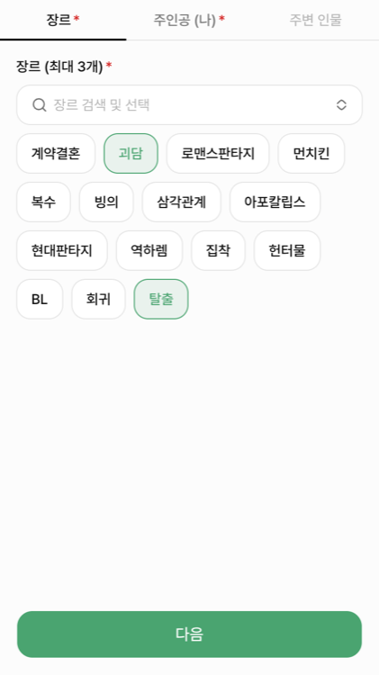
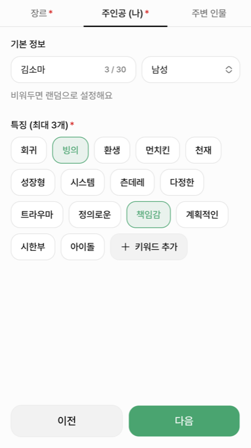
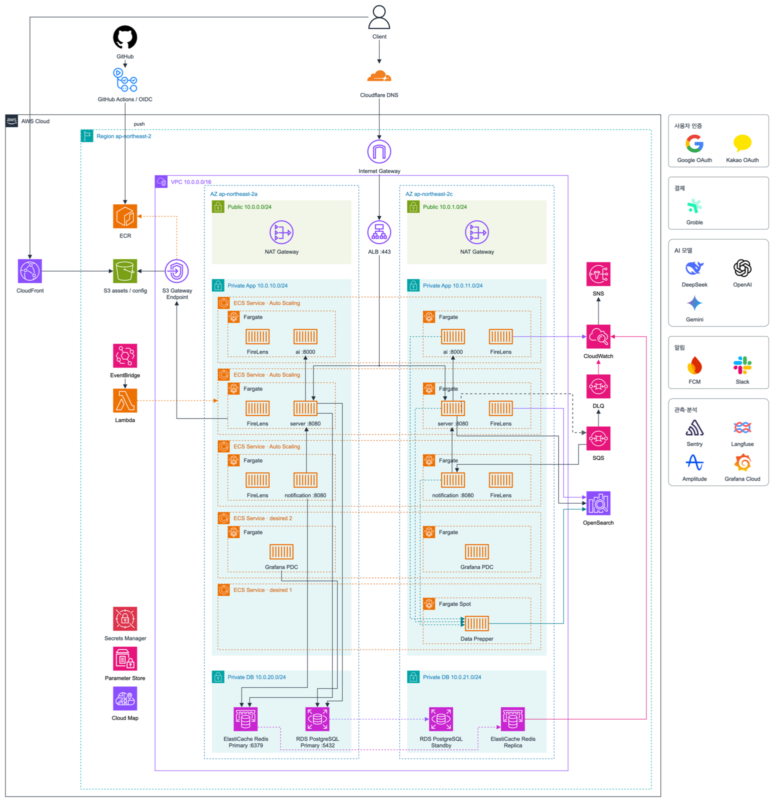
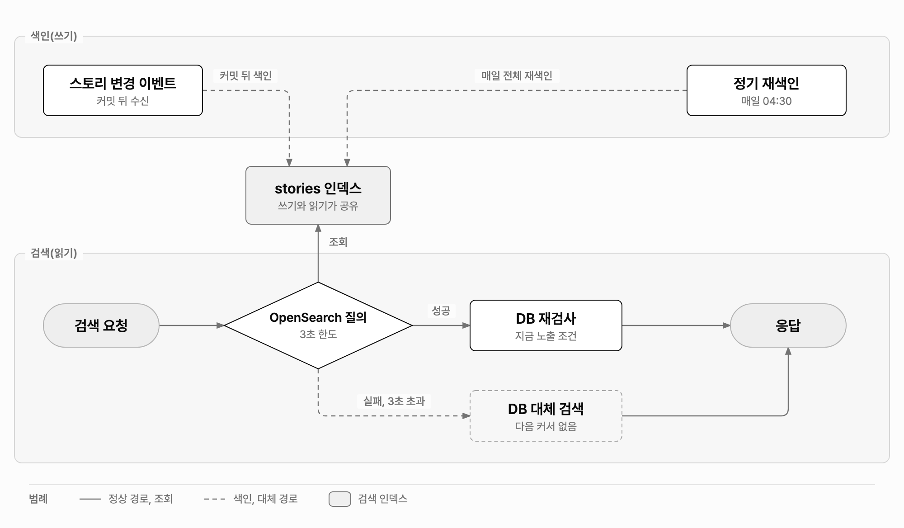
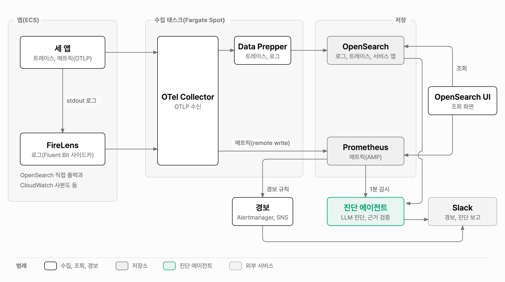
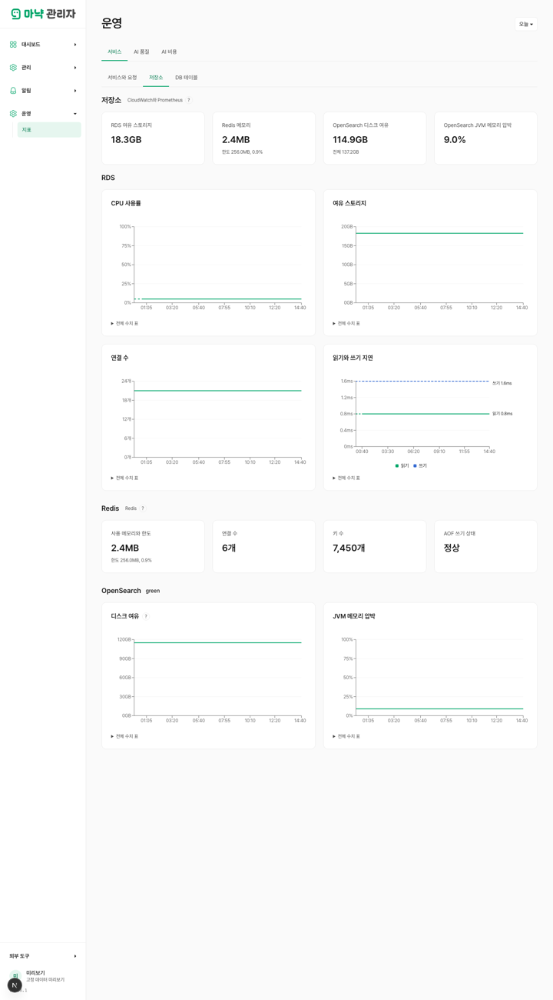

# manyak-server

AI 스토리 채팅 서비스 **마냑**의 API 서버

## 목차

- [1. 프로젝트 개요](#1-프로젝트-개요)
  - [1-1. 프로젝트 소개](#1-1-프로젝트-소개)
  - [1-2. 시스템 구성도](#1-2-시스템-구성도)
  - [1-3. 주요 기능](#1-3-주요-기능)
  - [1-4. 개발 환경](#1-4-개발-환경)
- [2. 개발 결과물](#2-개발-결과물)
  - [2-1. 백엔드 아키텍처](#2-1-백엔드-아키텍처)
  - [2-2. 인프라 아키텍처](#2-2-인프라-아키텍처)
  - [2-3. 데이터베이스 ERD와 마이그레이션](#2-3-데이터베이스-erd와-마이그레이션)
  - [2-4. API 문서화와 수동 검증](#2-4-api-문서화와-수동-검증)
  - [2-5. 테스트](#2-5-테스트)
  - [2-6. 리팩터링](#2-6-리팩터링)
  - [2-7. CI/CD 파이프라인](#2-7-cicd-파이프라인)
  - [2-8. 채팅 턴 스트리밍](#2-8-채팅-턴-스트리밍)
  - [2-9. 알림 파이프라인](#2-9-알림-파이프라인)
  - [2-10. 검색](#2-10-검색)
  - [2-11. 관측과 장애 진단](#2-11-관측과-장애-진단)
  - [2-12. 부하 테스트](#2-12-부하-테스트)
  - [2-13. 비용 최적화](#2-13-비용-최적화)
- [3. 수행 방법](#3-수행-방법)
  - [3-1. 스펙 주도 개발](#3-1-스펙-주도-개발)
  - [3-2. 형상 관리와 릴리스](#3-2-형상-관리와-릴리스)
  - [3-3. AI 에이전트 협업](#3-3-ai-에이전트-협업)
- [4. 개발 가이드](#4-개발-가이드)

## 1. 프로젝트 개요

### 1-1. 프로젝트 소개

마냑은 사용자가 고른 키워드로 AI가 스토리를 만드는 서비스입니다. 사용자는 그 스토리 속 인물과 채팅하며 이야기를 이어 갑니다. 서비스 주소는 <https://www.manyak.app>입니다.

이 레포는 마냑의 API 서버입니다. 회원과 인증, 스토리 제작과 탐색, 채팅 턴 생성, 재화(이프) 결제, 알림, 관리자 기능을 맡습니다. AI•SW 마에스트로 17기 김앤강 팀이 2026년 6월부터 개발했습니다.

관련 공개 레포는 다음과 같습니다.

| 레포 | 역할 |
| --- | --- |
| [knk-harness](https://github.com/KIM-N-KANG/knk-harness) | 도메인 스펙과 팀 공용 LLM 작업 하네스 |
| [manyak-ai](https://github.com/KIM-N-KANG/manyak-ai) | 스토리 생성, 채팅 턴 생성, 검수 AI 서버(Python, FastAPI) |
| [manyak-notification](https://github.com/KIM-N-KANG/manyak-notification) | 큐 소비와 푸시 발송 알림 서비스(Kotlin, Spring Boot) |
| [manyak-web](https://github.com/KIM-N-KANG/manyak-web) | 웹 클라이언트와 BFF(Next.js) |
| [manyak-android](https://github.com/KIM-N-KANG/manyak-android) | Android 앱 |
| [manyak-admin](https://github.com/KIM-N-KANG/manyak-admin) | 관리자 페이지 |

### 1-2. 시스템 구성도

서버는 요청마다 요청 ID를 붙입니다. AI 서버와 알림 서비스도 같은 요청 ID와 트레이스를 이어 받습니다.

### 1-3. 주요 기능

<table>
  <tr>
    <td align="center"></td>
    <td align="center"></td>
    <td align="center"></td>
    <td align="center"></td>
    <td align="center"></td>
  </tr>
  <tr>
    <td align="center">간편 제작: 장르</td>
    <td align="center">간편 제작: 주인공</td>
    <td align="center">간편 제작: 이미지 스타일</td>
    <td align="center">채팅 선택지</td>
    <td align="center">실시간 이미지</td>
  </tr>
</table>

- **스토리 제작**: 장르, 주인공, 주변 인물을 키워드로 고르면 AI가 스토리라인 세 개를 제안합니다. 그중 하나를 고르면 스토리가 완성됩니다. 직접 쓰는 일반 제작도 있습니다.
- **채팅**: 스토리 속 인물과 턴 단위로 대화합니다. 응답은 SSE로 보냅니다. 재생성, 선택지, 실시간 이미지, 입력 수정, 포크, 공유를 지원합니다.
- **탐색과 검색**: 홈 섹션, 공개 목록, 제목과 인물 이름 검색을 제공합니다.
- **이프와 결제**: 턴과 이미지 생성에는 재화 이프를 씁니다. 체험 이프와 결제 충전은 원장으로 관리합니다.
- **알림**: 스토리 완성, 검수 결과, 출석, 캠페인 푸시와 알림함을 제공합니다.
- **관리자**: 관리자 API로 운영 지표, 검수와 공개 중단, 캠페인, 이프 조정을 제공합니다.

### 1-4. 개발 환경

| 항목 | 버전 |
| --- | --- |
| Kotlin | 2.3.21 |
| Spring Boot | 4.1.2(Web MVC, Data JPA, Security, Actuator) |
| Java | 25 |
| Gradle | 9.5.1 |
| PostgreSQL | 16(로컬 기준), Flyway |
| Redis | 7 |
| OpenSearch | 클라이언트 3.10.0, nori 분석기 |
| 테스트 | JUnit 5, AssertJ, Testcontainers 2.0.3, ArchUnit 1.5.1 |
| 문서 | springdoc-openapi 3.0.3, tbls |
| 관측 | Spring Boot OpenTelemetry, Sentry |

## 2. 개발 결과물

### 2-1. 백엔드 아키텍처

서버는 모듈러 모놀리스입니다. `com.knk.manyak` 아래 최상위 패키지 하나가 모듈 하나입니다. 모듈은 14개입니다. 그림의 모듈 사이 화살표는 실제 코드 의존을 줄여 그린 것입니다.

모듈 경계는 ArchUnit 테스트(`ModuleBoundaryTests`)가 검사합니다. 위반이 하나라도 생기면 빌드가 실패합니다. 실패 메시지에는 위반한 클래스 쌍이 나옵니다.

| 규칙 | 내용 |
| --- | --- |
| R1 | 다른 모듈의 리포지토리와 엔티티 직접 참조 금지 그 모듈의 조회 서비스, 잠금 진입점, 명령을 호출함 |
| R2 | 모듈 사이 순환 금지 아래 모듈이 위 모듈을 알아야 하면 인터페이스나 이벤트를 아래 모듈에 둠 |
| G | `global`의 도메인 모듈 의존 금지 |

외부에 노출하는 식별자는 모두 UUID(`public_id`)입니다. 순차 PK는 API에 내보내지 않습니다. 오류 응답은 `code`, `message`, `details` 형태로 맞췄습니다.

### 2-2. 인프라 아키텍처

> 아래 구성은 최종 발표(2026년 11월 14일) 기준입니다.

인프라는 Ver.1부터 여섯 단계를 거쳐 Ver.6의 이중화 구성에 이르렀습니다.

#### Ver.1. 첫 운영과 계층 분리

EC2 한 대의 Docker Compose에서 server와 ai를 함께 실행하며 첫 운영을 시작했습니다. 네트워크는 퍼블릭, 앱, 데이터 서브넷으로 나눴습니다. RDS PostgreSQL과 Redis는 처음부터 관리형 서비스로 두었습니다. 배포는 SSM으로 했습니다.

#### Ver.2. 컨테이너 운영 전환

Docker Compose 구성을 ECS 태스크 하나로 옮겼습니다. 컨테이너 로그는 FireLens로 OpenSearch에 모았습니다. 배포는 새 태스크로 교체하는 방식으로 바꿨습니다. 전환을 마친 뒤 EC2는 회수했습니다.

#### Ver.3. 서비스 분리

푸시 발송을 독립 알림 서비스로 떼어 냈습니다. 알림 서비스와 잇는 데 SQS, DLQ, Cloud Map을 더했습니다. 알림 서비스가 호출하는 내부 API는 공개 ALB에서 막았습니다. 스토리 검색용 OpenSearch 색인(nori)도 이때 넣었습니다.

#### Ver.4. 이중화 계획

Ver.4는 계획안입니다. 세 앱을 두 가용 영역에 나눠 두고 RDS Multi-AZ, Redis 복제, 가용 영역별 NAT를 두는 안입니다. 이 계획은 Ver.5에서 적용했습니다.

#### Ver.5. 분산 추적과 이중화 적용

Data Prepper로 세 앱의 트레이스를 모았습니다. OpenSearch에서 서비스 맵과 트레이스를 볼 수 있습니다. Ver.4의 이중화도 이때 적용했습니다. 서비스마다 태스크를 최소 2개, 최대 4개로 오토스케일링합니다. RDS는 Multi-AZ, Redis는 자동 장애 조치가 켜진 복제 구성입니다.

#### Ver.6. 관측 통합

Ver.6은 두 가용 영역에 걸친 이중화 구성입니다.

- **앱**: server, ai, notification을 각각 ECS Fargate 서비스로 두고 서비스마다 오토스케일링합니다. notification은 Cloud Map 주소로 서버의 내부 API를 호출합니다. 공개 ALB는 내부 경로를 막습니다.
- **데이터**: RDS PostgreSQL은 Multi-AZ, ElastiCache Redis는 Primary와 Replica입니다. 가용 영역마다 NAT Gateway를 둡니다.
- **관측**: 세 앱의 OTLP를 OTel Collector가 받아 로그와 트레이스는 OpenSearch로, 메트릭은 Prometheus로 보냅니다.
- **배포**: 레포별 GitHub OIDC 역할로 ECR에 이미지를 올리고 ECS 서비스를 교체합니다.

### 2-3. 데이터베이스 ERD와 마이그레이션

테이블은 64개입니다. Flyway 마이그레이션은 125개(V1~V128)입니다. 아래 그림은 핵심 테이블 11개의 관계입니다.

스키마 문서는 [tbls](https://github.com/k1LoW/tbls)로 실제 DB에서 자동 생성합니다. CI(`db-docs.yml`)는 마이그레이션을 실제 PostgreSQL에 적용해 문서와 비교합니다. 차이가 나면 PR이 통과하지 못합니다. 전체 ERD와 테이블별 컬럼은 [dbdoc](dbdoc/README.md)에 있습니다.

### 2-4. API 문서화와 수동 검증

API 오퍼레이션은 앱용 93개, 관리자용 90개로 모두 183개입니다. 명세는 springdoc이 코드에서 OpenAPI로 생성합니다. 관리자 웹은 이 명세에서 요청 타입을 생성해 씁니다. 내부 API(`/internal/**`)는 공유 시크릿으로 보호합니다. 공개 명세에는 내부 API를 넣지 않습니다.

엔드포인트를 추가하거나 계약을 바꾸면 통합 테스트와 함께 [`http/`](http) 아래 수동 검증 파일을 고칩니다. 지금 파일은 84개입니다. IntelliJ HTTP Client로 바로 실행할 수 있습니다. 파일은 헬스 체크, 준비 요청, 핵심 검증, 오류 케이스 순서로 이어집니다. 응답 핸들러에서 상태 코드와 필드를 단언합니다.

### 2-5. 테스트

전체 테스트는 3,971개입니다(2026-11-20 실행 기준). 테스트의 기준은 하네스 스펙의 테스트 케이스 표입니다. 도메인마다 `5-5-TEST-CASES.md`에 확인 항목, 입력과 상황, 기대 결과를 행 단위로 적습니다. 테스트는 각 행의 입력과 기대 결과를 그대로 옮깁니다. 커버리지 수치 대신 모든 행이 테스트에 있는지 확인합니다.

기본 테스트 프로파일은 H2에서 컨트롤러부터 저장까지 통합 테스트로 확인합니다. 마이그레이션, PostgreSQL 전용 동작, 검색은 Testcontainers로 실제 PostgreSQL(16, 17)과 OpenSearch를 실행해 확인합니다. AI 서버는 테스트용 클라이언트로 바꿉니다. 분석 도구 같은 외부 API는 MockWebServer로 대신합니다.

테스트 실행 시간은 두 번에 걸쳐 줄였습니다.

| PR | 한 일 | 결과 |
| --- | --- | --- |
| [#480](https://github.com/KIM-N-KANG/manyak-server/pull/480) | 공용 베이스 클래스로 통합 테스트의 Spring 컨텍스트 공유 | 컨텍스트 조합 106개 → 23개(78% 감소) 컨텍스트 기동 125회 → 23회(82% 감소) 전체 496초 → 367초(26% 감소) |
| [#481](https://github.com/KIM-N-KANG/manyak-server/pull/481) | 테스트 전용 재시도와 대기 단축 PostgreSQL 컨테이너는 JVM당 한 번 실행, 클래스마다 DB 복제 | 전체 369초 → 195초(47% 감소) |

### 2-6. 리팩터링

모듈 경계를 측정하는 테스트를 먼저 넣었습니다. 그다음 위반 수를 기준선으로 고정하고 하나씩 줄였습니다. 위반을 늘리는 변경은 테스트가 실패합니다. 위반을 줄인 변경은 기준선도 함께 낮춰야 통과합니다. 세 규칙 모두 0이 된 뒤에는 기준선을 없애고, 위반이 하나라도 있으면 실패하게 했습니다.

| 규칙 | 기준선([#482](https://github.com/KIM-N-KANG/manyak-server/pull/482)) | 최종([#539](https://github.com/KIM-N-KANG/manyak-server/pull/539)) |
| --- | --- | --- |
| R1 다른 모듈의 리포지토리, 엔티티 참조 | 268 | 0 |
| R2 모듈 간 순환 간선 | 47(간선 58개 중) | 0 |
| G `global`의 도메인 의존 | 22 | 0 |

코드를 옮길 때마다 기존 테스트를 먼저 통과시켰습니다. 조회 수와 응답이 전후로 같은지도 확인했습니다. 예를 들어 게스트 이관의 쿼리 수는 경계를 고친 뒤에도 18개 그대로입니다. 스토리 목록 정렬에는 커버링 인덱스를 넣었습니다. 데이터를 10배와 100배로 늘린 실험에서 인기순 첫 페이지가 4.0~4.8배 빨라졌습니다. ([#507](https://github.com/KIM-N-KANG/manyak-server/pull/507))

### 2-7. CI/CD 파이프라인

- dev에 머지하면 테스트 뒤 두 아키텍처 이미지를 만들어 dev 환경에 배포합니다. 릴리스 PR이 main에 머지되면 같은 트리의 dev 테스트 결과를 다시 씁니다. 이때는 이미지만 새로 만듭니다.
- 배포 잡은 그 실행의 커밋 대신 main의 최신 커밋을 배포합니다. 늦게 끝난 옛 빌드가 최신 배포를 덮지 않게 하려는 것입니다. `latest` 태그도 이 직렬 구간에서만 옮깁니다.
- 교체할 때는 새 컨테이너가 헬스 검사를 통과한 뒤에 트래픽을 보냅니다. 옛 컨테이너는 그다음에 드레인합니다. 운영 릴리스 두 번(v0.15.1, v0.15.2)에서 배포 내내 1초 간격으로 헬스를 확인했습니다. 2,863번 모두 성공했습니다.
- dev와 main으로 가는 PR과 푸시마다 gitleaks가 그 범위의 커밋에서 비밀값 유출을 검사합니다. CodeQL(Kotlin, Actions, JavaScript, Python)은 PR과 dev 푸시, 매주 정기 실행에서 검사합니다.

### 2-8. 채팅 턴 스트리밍

- **중복 턴 방지**: 채팅마다 Redis에 생성 중 키를 하나만 둡니다. 키가 이미 있으면 새 요청을 거절합니다. 요청의 마지막 턴 ID가 지금 마지막 턴과 달라도 거절합니다. 두 기기에서 동시에 보내도 턴이 겹치지 않습니다.
- **생성 중 이탈과 재연결**: 생성 작업과 전달 연결을 나눴습니다. 생성 작업은 모든 SSE 이벤트를 생성별 Redis Stream에 기록합니다. 첫 연결과 재연결은 같은 스트림을 처음부터 읽습니다. 앱을 닫았다 열어도 생성 중인 턴을 이어 받습니다. 재연결은 새 AI 호출이나 과금을 만들지 않습니다.
- **과금 정합성**: 이프는 생성 전에 선차감합니다. 턴 저장이 확정되면 과금도 확정합니다. 저장 전에 작업이 어떤 이유로든 끝나면 차감을 환불하고 체험 횟수를 되돌립니다.

자세한 흐름은 하네스 스펙에 있습니다. ([CHAT 백엔드 파이프라인](https://github.com/KIM-N-KANG/knk-harness/blob/dev/docs/spec/CHAT/BACKEND/4-1-PIPELINES.md))

### 2-9. 알림 파이프라인

- **아웃박스**: 스토리 완성 같은 도메인 변경과 같은 트랜잭션에 발송 요청 행을 기록합니다. 커밋된 변경만 알림 요청이 됩니다. 커밋 직후 서버가 멈춰도 요청 행이 남아 다음 릴레이가 보냅니다.
- **릴레이와 멱등**: 릴레이는 행을 선점하고 임대 시각을 기록합니다. 발행은 트랜잭션 밖에서 SQS로 한꺼번에 합니다. 실패한 행은 백오프로 미룹니다. 24시간이 지나면 포기로 기록합니다. 완료를 기록하기 전에 장애가 나면 같은 메시지가 두 번 갈 수 있습니다. 알림 서비스는 메시지 ID로 처리 중 선점을 해서 중복 발송을 막습니다.
- **트레이스 연결**: 요청 중에 기록한 행에는 그 요청의 추적 헤더를 저장합니다. 릴레이는 발행할 때 저장한 헤더를 큐 메시지 속성에 싣습니다. 알림 서비스의 발송 스팬은 원래 API 요청 트레이스에 이어집니다. 그래서 어느 요청이 어떤 푸시를 만들었는지 한 트레이스에서 확인할 수 있습니다.

### 2-10. 검색

제목, 한 줄 소개, 장르, 인물 이름을 nori 분석기로 색인합니다. 제목에는 가중치를 더 줍니다. 매일 하는 전체 재색인은 이벤트를 놓쳐 어긋난 문서를 바로잡습니다. 검색 결과는 DB에서 지금 노출 조건을 다시 확인합니다. 그래서 비공개로 바뀐 스토리는 결과에 나오지 않습니다.

검색 저장소가 실패하거나 3초를 넘기면 더 기다리지 않습니다. DB에서 제목, 한 줄 소개, 장르를 찾아 응답합니다.

### 2-11. 관측과 장애 진단

세 앱은 OpenTelemetry로 로그, 트레이스, 메트릭을 보냅니다. 로그에는 요청 ID와 트레이스 ID가 함께 남습니다. 그래서 로그 한 줄에서 서버, AI, 알림 서비스까지 이어진 트레이스로 바로 넘어갈 수 있습니다. 애플리케이션 오류는 Sentry, LLM 호출과 비용은 Langfuse, 사용자 행동은 Amplitude로 확인합니다.

**진단 에이전트**는 장애 후보의 원인을 진단하는 별도 서비스입니다. 1분마다 규칙으로 감시합니다. 이상 후보가 3분 이어지면 LLM이 읽기 전용 도구로 트레이스, 로그, 메트릭을 조회해 진단합니다. 진단 근거는 코드로 다시 검증한 뒤 Slack에 보고합니다. 부하 테스트에서 찾은 병목 4건을 재현해 평가했습니다. 3건은 두 번 모두 원인을 맞혔습니다. DB CPU 포화는 장애 감지만 맞혔습니다. 보관 자료를 다시 넣은 평가에서는 DB CPU 포화도 다섯 번 모두 원인을 맞혔습니다. 진단 한 건의 비용은 $0.1~0.3입니다.

관리자 페이지의 운영 탭은 RDS, Redis, OpenSearch 같은 인프라 지표를 한곳에 모아 보여 줍니다.

### 2-12. 부하 테스트

운영과 같은 사양의 별도 환경에 운영 DB 스냅샷을 복원해 측정했습니다(2026-10-08 ~ 11-03). LLM은 응답에 10.4초 걸리는 가짜 서버로 바꿨습니다. k6 가상 사용자는 실제 사용자처럼 32초에 한 턴을 보냅니다. 시나리오 코드는 [`loadtest/k6`](loadtest/k6)에 있습니다.

| 지표 | 수정 전 | 수정 후 |
| --- | --- | --- |
| 동시 채팅 수용 인원 | 25명 | 약 390명(약 15.6배) |
| 턴 p95, 25명 | 25초 | 10.6초(58% 감소) |
| 턴 p95, 50명 | 68초 | 10.6초(84% 감소) |
| 턴 p95, 100명 | 70초 | 10.6초(85% 감소) |
| 턴 p95, 200명 | 69초 | 10.9초(84% 감소) |
| 100명 실패율 | 30% | 0% |

병목은 4건이었습니다. 가장 큰 병목은 채팅 턴 실행기의 실질 스레드가 4개뿐이라 턴이 큐에서 기다린 문제였습니다. 서버를 늘리지 않고 실행기 설정 하나를 고쳐 해결했습니다(v0.7.3). 나머지 3건은 동시 턴 상한, AI 서버 CPU 확장 기준, 목록 집계로 인한 DB CPU 포화입니다. 앞의 두 가지는 부하 환경에서 수정안을 검증했습니다.

### 2-13. 비용 최적화

이중화와 관측 확장으로 AWS 비용이 늘었습니다. 서비스별 7일 사용량을 근거로 태스크 사양을 줄이고 Fargate Spot과 Graviton으로 옮겼습니다. 다중 AZ 구성은 그대로 두고 월 환산 비용을 약 560달러에서 약 400달러로(29% 감소) 낮췄습니다.

| 항목 | 줄이기 전(11/02~11/09, 8일 평균) | 줄인 뒤(11/11~11/15, 5일 평균) |
| --- | --- | --- |
| 하루 평균 | 18.75 | 13.30(29% 감소) |
| 30일 환산 | 약 560 | 약 400(29% 감소) |
| 그중 ECS(Fargate) 하루 평균 | 7.15 | 2.32(68% 감소) |

금액은 청구 상세의 기간 평균입니다. 단위는 USD이고 VAT는 뺐습니다. 두 기간 모두 두 가용 영역, Multi-AZ RDS, Redis 복제, NAT 2개의 이중화를 유지한 상태입니다. 바꾼 것은 다음과 같습니다.

- 서비스별 7일 CloudWatch 시간별 최대 사용량에 맞춰 태스크 사양을 정했습니다(비공개 인프라 레포 PR #136). 예를 들어 server는 CPU p95가 40.5%여서 1 vCPU에서 0.5 vCPU로(50% 감소) 낮췄습니다.
- server와 ai는 온디맨드 태스크 1개를 기본으로 둡니다. 나머지 태스크는 Fargate Spot으로 실행합니다.
- 앱 태스크를 Graviton(ARM64)으로 옮겼습니다. RDS와 Redis도 t4g로 바꿨습니다. 이미지는 두 아키텍처로 빌드합니다.

## 3. 수행 방법

### 3-1. 스펙 주도 개발

기능은 [knk-harness](https://github.com/KIM-N-KANG/knk-harness)의 도메인 스펙에서 시작합니다. 회원, 스토리, 채팅, 결제, 알림, 공지, 검수, 관리자 8개 도메인마다 요구사항, 소프트웨어 구조, DB 스키마, 파이프라인, API 계약, 보안, 동시성, 오류 처리, 관측, 테스트 케이스 문서가 있습니다. 하네스의 도메인 문서는 383개입니다.

스펙이 기준입니다. 코드와 스펙이 다르면 코드를 스펙에 맞춥니다. 스펙이 모호하면 구현 전에 정합니다. 설계를 바꿀 때는 스펙부터 고칩니다. 코드와 테스트는 그 변경에 맞춥니다. 선택의 이유는 도메인별 `DECISIONS.md`에 남깁니다.

### 3-2. 형상 관리와 릴리스

기능 브랜치는 최신 `dev`에서 만들어 Squash로 머지합니다. 릴리스는 `dev`에서 만든 `release/vX.Y.Z`를 `main`에 Merge Commit으로 머지합니다. 머지한 커밋에는 태그를 붙입니다. `main` 머지가 운영 배포를 시작합니다. 릴리스 PR에는 포함 PR과 함께 이미지 배포만으로 끝나지 않는 "코드 외 할 일"을 적습니다. 그 항목이 모두 끝나야 릴리스를 닫습니다.

브랜치, 커밋, PR 제목은 Jira 티켓 키로 묶습니다(`[KNK-123] Feat: ...`). 2026-06-25 v0.1.0부터 2026-11-20 v0.15.2까지 태그 78개를 붙였습니다. 병합한 PR은 562개입니다.

### 3-3. AI 에이전트 협업

개발에는 LLM 에이전트를 씁니다. 계획과 검수를 맡는 에이전트가 작업 지시서를 씁니다. 구현을 맡는 에이전트는 브랜치, 커밋, 테스트, PR까지 진행합니다. 두 에이전트 모두 같은 하네스의 규칙과 스킬(브랜치, 커밋, PR, 리뷰 절차)을 따릅니다.

작업의 기준은 스펙과 테스트 행입니다. 구현 에이전트는 스펙의 테스트 행을 먼저 테스트로 옮깁니다. PR 전에는 다른 모델로 로컬 코드 리뷰를 합니다. CI를 통과해야 머지합니다. 머지와 운영 릴리스는 사람이 승인합니다.

## 4. 개발 가이드

로컬 실행, 환경 변수, 엔드포인트, 스키마 문서 생성 방법은 [docs/DEVELOPMENT.md](docs/DEVELOPMENT.md)에 있습니다.
