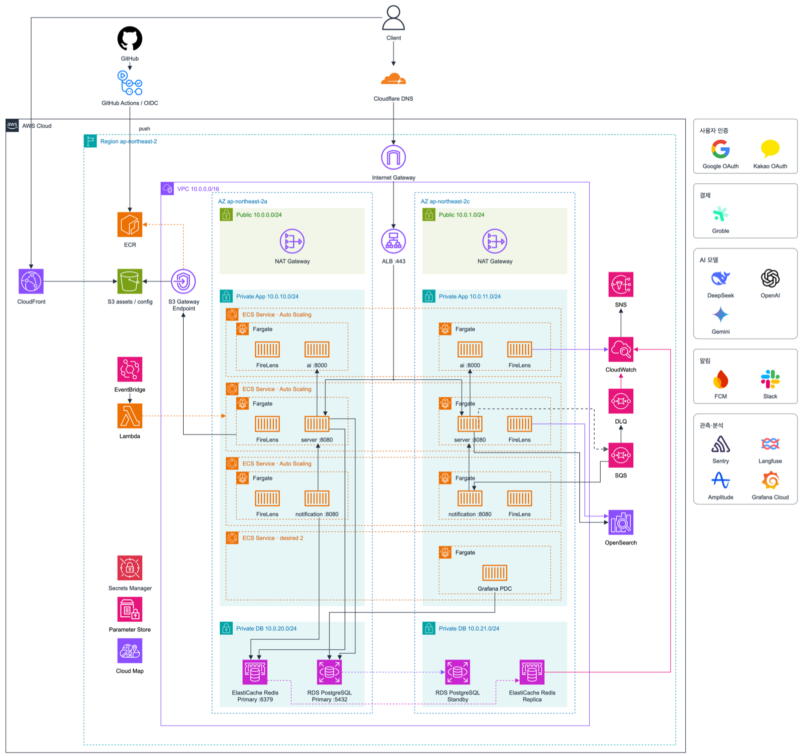
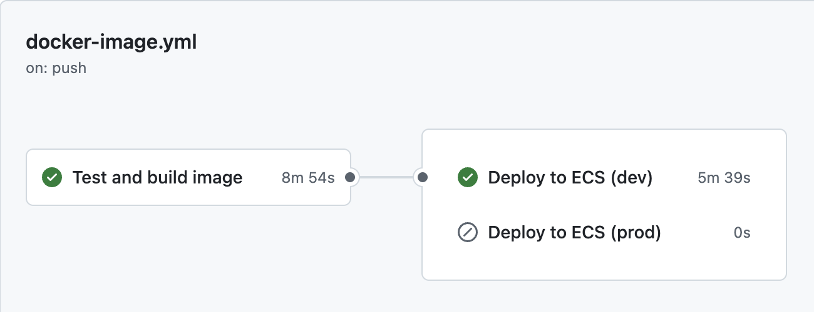
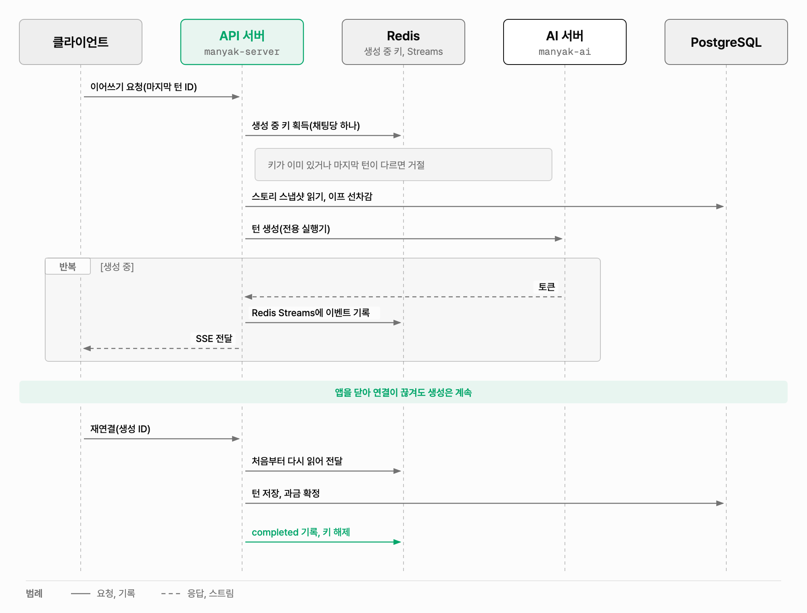
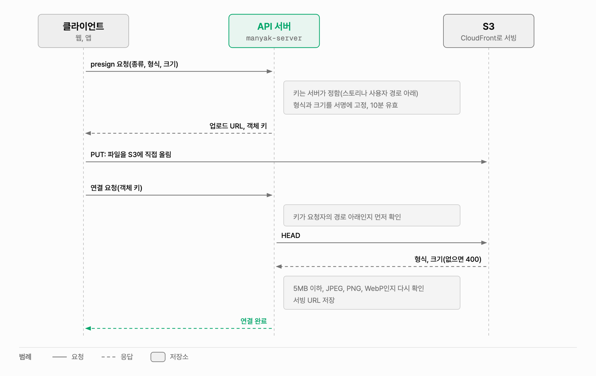

<div align="center">


# manyak-server

AI 스토리 채팅 서비스 **마냑**의 API 서버

</div>

## 목차

- [1. 프로젝트 개요](#1-프로젝트-개요)
  - [1-1. 프로젝트 소개](#1-1-프로젝트-소개)
  - [1-2. 시스템 구성도](#1-2-시스템-구성도)
  - [1-3. 주요 기능](#1-3-주요-기능)
  - [1-4. 개발 환경](#1-4-개발-환경)
- [2. 개발 결과물](#2-개발-결과물)
  - [2-1. 백엔드 아키텍처](#2-1-백엔드-아키텍처)
  - [2-2. 인프라 아키텍처](#2-2-인프라-아키텍처)
  - [2-3. 데이터베이스 ERD와 마이그레이션](#2-3-데이터베이스-erd와-마이그레이션)
  - [2-4. API 문서화와 수동 검증](#2-4-api-문서화와-수동-검증)
  - [2-5. 테스트](#2-5-테스트)
  - [2-6. 리팩터링](#2-6-리팩터링)
  - [2-7. CI/CD 파이프라인](#2-7-cicd-파이프라인)
  - [2-8. 채팅 턴 스트리밍](#2-8-채팅-턴-스트리밍)
  - [2-9. 알림 파이프라인](#2-9-알림-파이프라인)
  - [2-10. 검색](#2-10-검색)
  - [2-11. 이미지 업로드](#2-11-이미지-업로드)
  - [2-12. 관측과 장애 진단](#2-12-관측과-장애-진단)
  - [2-13. 부하 테스트](#2-13-부하-테스트)
  - [2-14. 비용 최적화](#2-14-비용-최적화)
- [3. 수행 방법](#3-수행-방법)
  - [3-1. 스펙 주도 개발](#3-1-스펙-주도-개발)
  - [3-2. 형상 관리와 릴리스](#3-2-형상-관리와-릴리스)
  - [3-3. AI 에이전트 협업](#3-3-ai-에이전트-협업)
- [4. 개발 가이드](#4-개발-가이드)

## 1. 프로젝트 개요

### 1-1. 프로젝트 소개

마냑은 사용자가 고른 태그로 AI가 스토리를 생성하는 서비스입니다. 사용자는 그 속의 인물과 채팅하며 스토리를 이어 갑니다. 서비스 주소는 <https://www.manyak.app>입니다.

이 레포는 마냑의 API 서버입니다. 회원과 인증, 스토리 제작과 탐색, 채팅 턴 생성, 이프와 결제, 알림, 관리자 기능을 맡습니다. AI•SW 마에스트로 17기 김앤강 팀이 2026년 6월부터 개발했습니다.

| 레포 | 역할 |
| --- | --- |
| [knk-harness](https://github.com/KIM-N-KANG/knk-harness) | 도메인 스펙과 LLM 에이전트의 작업 규칙, 도구 모음(하네스) |
| [manyak-ai](https://github.com/KIM-N-KANG/manyak-ai) | 스토리와 채팅 턴을 생성하는 AI 서버(Python, FastAPI) |
| [manyak-notification](https://github.com/KIM-N-KANG/manyak-notification) | 푸시를 보내는 알림 서비스(Kotlin, Spring Boot) |
| [manyak-web](https://github.com/KIM-N-KANG/manyak-web) | 웹 클라이언트와 BFF(Next.js) |
| [manyak-android](https://github.com/KIM-N-KANG/manyak-android) | Android 앱 |
| [manyak-admin](https://github.com/KIM-N-KANG/manyak-admin) | 관리자 페이지 |

### 1-2. 시스템 구성도


### 1-3. 주요 기능

<table>
  <tr>
    <td align="center"></td>
    <td align="center"></td>
    <td align="center"></td>
    <td align="center"></td>
    <td align="center"></td>
  </tr>
  <tr>
    <td align="center">간편 제작: 장르</td>
    <td align="center">간편 제작: 주인공</td>
    <td align="center">간편 제작: 화풍</td>
    <td align="center">채팅 선택지</td>
    <td align="center">실시간 이미지</td>
  </tr>
</table>

- **스토리 제작**: 장르, 주인공, 주변 인물의 태그를 고르면 AI가 스토리라인 세 개를 제안하고, 하나를 고르면 스토리가 완성됩니다.
- **채팅**: 스토리 속 인물과 턴 단위로 대화합니다. 응답 재생성, 선택지, 실시간 이미지, 특정 턴까지 복사한 새 채팅을 지원합니다.
- **탐색과 알림**: 홈 섹션, 공개 목록, 검색과 푸시 알림을 제공합니다.
- **이프와 관리자**: 턴과 이미지 생성에 재화인 이프를 쓰고, 관리자 API로 검수와 운영 지표를 관리합니다.

### 1-4. 개발 환경

- **서버**: Kotlin 2.3.21, Spring Boot 4.1.2, Java 25, Gradle 9.5.1
- **저장소**: PostgreSQL 16과 Flyway, Redis 7, OpenSearch(nori)
- **테스트와 문서**: JUnit 5, Testcontainers, ArchUnit, springdoc-openapi, tbls
- **관측**: OpenTelemetry, Sentry

## 2. 개발 결과물

### 2-1. 백엔드 아키텍처

모듈 사이 의존이 얽히면 한 기능을 고칠 때 다른 기능까지 함께 깨지기 쉽습니다. 그래서 서버는 하나의 애플리케이션을 모듈 14개로 나누고(모듈러 모놀리스), 그 경계를 테스트로 지킵니다. 다른 모듈의 리포지토리나 엔티티를 직접 참조하거나 모듈끼리 순환하면 모듈 경계 테스트(ArchUnit)가 실패하고 빌드가 멈춥니다.


모듈 사이 화살표는 실제 코드 의존을 줄여 그린 것으로, 모두 위 모듈에서 아래 모듈로 향합니다. 회원, 스토리, 채팅의 공개 ID는 UUID(`public_id`)이고, 오류 응답에는 `code`, `message`, `details` 등 공통 필드를 둡니다.

### 2-2. 인프라 아키텍처

> 아래 인프라는 두 가용 영역 이중화를 유지한 마지막 구성으로, 2026년 11월 14일 최종 발표 때의 모습입니다.


Ver.5까지는 트레이스와 지표를 서로 다른 경로로 보냈고, Ver.6에서 OTel Collector 하나로 모았습니다.

<details>
<summary><b>Ver.1 ~ Ver.5 발전 과정</b></summary>

<br>

**1) Ver.1 첫 운영과 계층 분리**


EC2 한 대의 Docker Compose에서 server와 ai를 실행하고 퍼블릭, 앱, 데이터 서브넷을 나눴습니다. RDS와 Redis는 처음부터 관리형으로 두었습니다.

**2) Ver.2 컨테이너 운영 전환**


배포 중에 서비스가 잠시 멈췄습니다. RDS 비밀번호가 바뀌어도 EC2 설정은 그대로라 DB 인증에 실패한 일도 있었습니다. Compose 구성을 ECS 태스크로 옮기고 EC2는 회수했습니다.

**3) Ver.3 서비스 분리**


푸시 발송이 실패하면 다시 보내지 않았습니다. 발송을 SQS와 별도 알림 서비스로 나누고, AI 서버도 혼자 배포할 수 있게 했습니다.

**4) Ver.4 이중화 계획**



RDS, Redis, NAT가 모두 한 가용 영역에 있어 그 영역에 장애가 나면 서비스도 멈출 수 있었습니다. 두 가용 영역에 나누는 계획안입니다.

**5) Ver.5 분산 추적과 이중화 적용**


요청 ID만으로는 채팅 턴 처리가 어디서 멈췄는지 찾지 못했습니다. Data Prepper로 세 앱의 트레이스를 모으고, Ver.4의 이중화를 적용했습니다.

</details>

### 2-3. 데이터베이스 ERD와 마이그레이션

손으로 그린 ERD는 스키마가 바뀔 때마다 따로 고쳐야 해서 실제 DB와 어긋나기 쉽습니다. 그래서 스키마 문서는 [tbls](https://github.com/k1LoW/tbls)로 실제 DB에서 만들고, CI가 마이그레이션을 적용한 DB와 문서가 다르면 PR을 막습니다. 전체 ERD와 테이블별 컬럼은 [dbdoc](dbdoc/README.md)에 있습니다.


그림은 테이블 64개 가운데 핵심 11개의 관계입니다. 도메인별로는 스토리 30개, 채팅 9개, 이프와 결제 7개, 알림 6개, 회원과 인증 5개, 관리자 4개, 그 밖 3개입니다.

### 2-4. API 문서화와 수동 검증

클라이언트가 웹, Android, 관리자 웹 셋이라 API 계약이 어긋나면 여러 곳이 함께 깨집니다. 그래서 명세는 코드에서 만들고, 사람이 직접 눌러 보는 검증 파일도 계약과 함께 고칩니다.

**OpenAPI 명세**

API 183개(앱 93개, 관리자 90개)의 OpenAPI 명세는 springdoc이 코드에서 만듭니다. 관리자 웹은 이 명세로 요청 타입을 생성합니다. 서비스끼리만 쓰는 내부 API는 공유 시크릿으로 보호하고 공개 명세에서 뺍니다.

**수동 검증 파일**

엔드포인트를 바꾸면 통합 테스트와 함께 [`http/`](http) 아래 수동 검증 파일(84개)을 고칩니다. IntelliJ HTTP Client로 바로 실행하며, 헬스 체크, 준비 요청, 핵심 검증, 오류 케이스 순서로 상태 코드와 필드를 확인합니다.

### 2-5. 테스트

전체 테스트 3,971개가 모두 통과합니다(2026-11-21 실행). 하네스 스펙의 테스트 케이스 표에 정의된 입력과 기대 결과를 테스트로 옮기고, 대부분 컨트롤러부터 DB 저장까지 확인하는 통합 테스트로 씁니다. PostgreSQL과 OpenSearch 동작은 Testcontainers로 실제 저장소를 띄워 확인합니다. JaCoCo로 잰 커버리지는 라인 96.7%, 분기 83.3%입니다(2026-11-21 측정).

**실행 시간 단축**

테스트가 늘면서 전체 실행에 8분이 넘게 걸려 PR 확인이 느려졌습니다. 통합 테스트끼리 Spring 컨텍스트를 함께 쓰게 해 컨텍스트 기동을 125회에서 23회로 줄이고([#480](https://github.com/KIM-N-KANG/manyak-server/pull/480)), PostgreSQL 컨테이너는 JVM마다 한 번만 띄워 클래스마다 DB를 복제하게 했습니다([#481](https://github.com/KIM-N-KANG/manyak-server/pull/481)). 전체 실행 시간은 496초에서 196초로 60% 줄었습니다.

### 2-6. 리팩터링

모듈 경계 규칙을 테스트로 강제하려고 보니 위반이 이미 수백 건 쌓여 있었습니다. 그래서 위반을 세는 테스트를 먼저 넣고, 위반이 늘지 않게 막은 채 하나씩 줄였습니다. 다른 모듈의 리포지토리와 엔티티를 참조하던 268곳, 모듈 사이 순환 47건, `global`의 도메인 의존 22건을 모두 없앴습니다([#482](https://github.com/KIM-N-KANG/manyak-server/pull/482) 기준선, [#539](https://github.com/KIM-N-KANG/manyak-server/pull/539) 마지막 정리). 이제 위반이 하나라도 생기면 빌드가 실패합니다.

<details>
<summary><b>리팩터링 예: 의존 방향 뒤집기</b></summary>

<br>

story 모듈이 누적 턴 수를 세려고 chat 모듈의 리포지토리를 직접 불렀습니다. story가 인터페이스를 정의하고 chat이 구현하게 바꿔 `story → chat` 의존을 없앴습니다. 동작은 그대로입니다([#484](https://github.com/KIM-N-KANG/manyak-server/pull/484)).

**변경 전**

```kotlin
// story/service/StoryService.kt
import com.knk.manyak.chat.repository.StoryChatRepository

turnCount = storyChatRepository.sumTurnCountByStoryId(story.id),
```

**변경 후**

```kotlin
// story/service/StoryTurnCounts.kt
interface StoryTurnCounts {
    fun countByStoryId(storyId: Long): Long
    // 여러 스토리를 한 번에 세는 메서드는 생략
}

// chat/service/ChatStoryTurnCounts.kt
@Component
class ChatStoryTurnCounts(private val storyChatRepository: StoryChatRepository) : StoryTurnCounts {
    // chat의 리포지토리로 세는 구현은 생략
}

// story/service/StoryService.kt
turnCount = storyTurnCounts.countByStoryId(story.id),
```

</details>

### 2-7. CI/CD 파이프라인

머지할 때마다 테스트, 이미지 빌드, 배포를 손으로 하면 빠뜨리는 단계가 생기고, 늦게 끝난 옛 빌드가 최신 배포를 덮을 수도 있습니다. 그래서 GitHub Actions가 테스트 뒤 amd64와 arm64 이미지를 만들어 배포하고, dev와 main의 배포 잡은 각 브랜치의 최신 커밋만 배포합니다. 릴리스 PR이 main에 머지될 때 같은 코드로 성공한 dev 실행이 있으면 테스트를 다시 돌리지 않고 이미지만 새로 만듭니다.


최종 발표 시점의 운영 배포(ECS)는 latest 태그를 먼저 옮긴 뒤 서비스를 교체하고, 헬스나 스모크 검사에 실패하면 태그를 직전 이미지로 되돌려 다시 배포합니다. gitleaks는 dev와 main을 대상으로 한 PR과 두 브랜치 푸시마다 비밀값 유출 여부를, CodeQL은 같은 PR과 dev 푸시, 매주 정기 실행에서 코드 취약점을 검사합니다.

**실행 화면**



2026-11-13 dev 푸시 한 번의 실행입니다. 테스트와 이미지 빌드 잡이 끝나면 dev 배포 잡만 돌고, 운영 배포 잡은 main 푸시가 아니어서 건너뜁니다.

### 2-8. 채팅 턴 스트리밍

AI 응답이 끝나기까지 10초 안팎이 걸려, 그사이 사용자가 앱을 닫거나 다른 기기에서 다시 보낼 수 있습니다. 그래서 생성 작업과 클라이언트 연결을 나눴습니다. 생성 작업은 모든 SSE 이벤트를 Redis Stream에 기록하고, 첫 연결과 재연결은 같은 스트림을 처음부터 읽습니다. 앱을 닫았다 열어도 새 AI 호출이나 과금 없이 생성 중인 턴을 이어 받습니다.



채팅마다 생성 중 키를 하나만 두고 요청의 마지막 턴 ID도 맞춰 보므로, 두 기기에서 동시에 보내도 턴이 겹치지 않습니다. 이프는 생성 전에 차감하고, 턴을 저장하지 못하면 차감을 환불하고 체험 횟수도 되돌립니다.

### 2-9. 알림 파이프라인

알림을 커밋 뒤에 바로 보내면, 그사이 서버가 멈추거나 발송이 실패할 때 알림이 사라집니다. 그래서 발송 요청을 도메인 변경과 같은 트랜잭션에 아웃박스 행으로 기록하고, 릴레이가 이를 선점해 SQS로 발행합니다. 실패한 행은 간격을 늘려 다시 보내고, 24시간이 지나면 포기로 기록합니다.


릴레이가 완료를 기록하기 전에 멈추면 같은 메시지가 두 번 갈 수 있어, 알림 서비스가 메시지 ID로 처리 중 선점을 해서 같은 메시지의 중복 처리를 줄입니다. 요청의 추적 헤더를 큐 메시지에 실어, 어느 요청이 어떤 푸시를 만들었는지 한 트레이스에서 봅니다.

### 2-10. 검색

한국어 제목과 인물 이름을 형태소 단위로 찾으려고 OpenSearch와 nori 분석기를 씁니다. 제목, 한 줄 소개, 장르, 인물 이름을 색인하고 제목에는 가중치를 더 줍니다. 스토리가 바뀌면 커밋 뒤에 색인하고, 매일 한 번 전체를 다시 색인해 놓친 변경을 바로잡습니다.


검색 결과는 DB에서 지금 노출 조건을 다시 확인하므로, 색인이 늦어도 비공개로 바뀐 스토리는 나오지 않습니다. 검색 저장소가 실패하거나 3초를 넘기면 첫 페이지는 DB에서 제목, 한 줄 소개, 장르로 찾아 응답합니다.

### 2-11. 이미지 업로드

이미지가 서버를 거치면 큰 파일이 서버의 메모리와 대역폭을 씁니다. 그래서 클라이언트가 서버에서 서명된 URL을 받아 S3에 바로 올리고, 서버는 발급과 확인만 합니다. 이미지가 여러 장인 제출은 S3 확인 요청을 동시에 보내 접수 시간을 2,205\~2,563ms에서 304\~541ms로 줄였습니다([#544](https://github.com/KIM-N-KANG/manyak-server/pull/544)).



키를 서버가 정하는 것은 남의 스토리 경로나 프리셋 이미지를 덮어쓰지 못하게 하려는 것이고, 연결할 때 키가 요청자의 경로 아래인지 확인한 뒤에야 S3에 객체 확인 요청(HEAD)을 보내는 것은 다른 사용자의 객체가 있는지 알아내지 못하게 하려는 것입니다. 채팅 실시간 이미지도 AI 서버가 같은 방식으로 올립니다.

### 2-12. 관측과 장애 진단

장애가 나면 서버, AI 서버, 알림 서비스 가운데 어디서 느려졌는지부터 찾아야 합니다. 그래서 요청 처리 로그에 요청 ID와 트레이스 ID를 함께 기록해, 로그에서 그 요청의 트레이스(서버부터 AI 서버, 알림 서비스까지)를 바로 찾게 했습니다. 오류는 Sentry, LLM 호출과 비용은 Langfuse, 사용자 행동은 Amplitude로 확인합니다.


그림은 최종 발표 시점의 구성으로, 세 앱의 트레이스, 지표, 로그가 수집 태스크 하나를 거쳐 저장되고 경보와 진단 에이전트가 같은 저장소를 읽습니다.

**진단 에이전트**

진단 에이전트는 지표가 기준을 넘어 이상 징후가 감지되면 3분 동안 신호를 더 모은 뒤, LLM이 읽기 전용 도구로 트레이스, 로그, 지표를 조회해 원인을 진단하고 Slack에 보고합니다. 부하 테스트에서 찾은 병목 4건을 각각 두 번씩 진단한 평가에서 3건의 원인을 두 번 모두 맞혔고, 보관한 지표, 로그, 트레이스를 재생한 자료로 진단한 평가(2026-11-15)에서는 나머지 1건(DB CPU 포화)도 다섯 번 모두 맞혔습니다(원인이 맞는지는 운영자가 판정). 진단 한 건의 비용은 0.1\~0.3달러입니다.

**관리자 운영 탭**


관리자 페이지의 운영 탭은 RDS, Redis, OpenSearch 같은 인프라 지표를 한곳에 모아 보여 줍니다(화면은 고정 데이터).

### 2-13. 부하 테스트

동시 사용자가 늘 때 어디서 먼저 막히는지 알아야 했습니다. 그래서 운영과 같은 사양의 별도 환경에 운영 DB 스냅샷을 복원해 채팅 부하를 측정했습니다(2026-10-08 \~ 11-03). LLM 대신 응답에 10.4초 걸리는 모의 서버를 두었습니다.

| 병목 | 수정 | 결과 |
| --- | --- | --- |
| 채팅 턴 실행기가 턴을 4개씩만 동시에 실행 | 동시 실행 수를 64로(v0.7.3, 운영 반영) | 수용 인원 25명 → 약 390명<br>100명 턴 p95 70초 → 10.6초 |
| 400명에서 동시 턴 상한 64 도달 | 상한 128(부하 환경에서 검증) | 실패율 1.9% → 0.4% |
| 500명에서 AI 서버 CPU가 확장 기준 70%에 못 미침 | 기준 50%(부하 환경에서 검증) | AI 턴 p95 13\~16초 → 12.0\~12.5초 |
| 목록 집계 쿼리로 DB CPU 포화 | 턴 수를 따로 저장하는 방식으로 바꿀 예정 | 채팅 6.5만 행에서 RDS CPU 96\~99% |

가장 큰 병목은 서버를 늘리지 않고 설정 하나를 바꿔 해결했습니다. 동시 턴 상한과 AI 서버 확장 기준은 부하 환경에서 수정안을 검증했고, DB CPU 포화는 다음 작업으로 남겼습니다.

### 2-14. 비용 최적화

이중화와 관측을 늘리면서 AWS 비용도 늘었습니다. 그래서 이중화는 그대로 두고 서비스별 7일 사용량에 맞춰 비용을 줄였습니다. 예를 들어 server는 CPU 사용률 p95가 40.5%라 1 vCPU에서 0.5 vCPU로 낮췄습니다. server와 ai는 온디맨드 태스크 하나에 Fargate Spot을 더하고, notification과 진단 에이전트는 Spot으로 실행합니다. 앱 태스크와 RDS, Redis는 Graviton(ARM64)으로 옮겼습니다.

| 항목 | 줄이기 전(11/02\~11/09 평균) | 줄인 뒤(11/11\~11/15 평균) |
| --- | --- | --- |
| 하루 평균(USD) | 18.75 | 13.30(29% 감소) |
| 30일 환산(USD) | 약 560 | 약 400 |

두 기간 모두 가용 영역 두 곳, Multi-AZ RDS, Redis 복제를 유지했습니다. 금액은 청구 상세의 기간 평균이고 부가가치세는 뺐습니다.

## 3. 수행 방법

### 3-1. 스펙 주도 개발

여러 사람과 LLM 에이전트가 나눠 구현하면 기준이 코드마다 달라지기 쉽습니다. 그래서 기능은 [knk-harness](https://github.com/KIM-N-KANG/knk-harness)의 도메인 스펙에서 시작합니다. 8개 도메인마다 요구사항, 구조, DB 스키마, API 계약, 테스트 케이스 문서가 있고, 스펙 문서는 모두 383개입니다. 코드와 스펙이 다르면 코드를 스펙에 맞추고, 설계를 바꿀 때는 스펙부터 고칩니다. 선택의 이유는 도메인별 결정 기록에 남깁니다.

### 3-2. 형상 관리와 릴리스


기능 브랜치는 `dev`에 Squash로 머지합니다. `dev`에서 만든 `release/vX.Y.Z`는 `main`에 Merge Commit으로 머지하고 태그를 붙이며, `main`에 머지하면 운영 배포가 시작됩니다. `dev`에 아직 내보내면 안 되는 변경이 있는데 운영 수정이 급할 때만 `main`에서 `hotfix/` 브랜치를 만듭니다.

브랜치 이름, 커밋 메시지, PR 제목에 Jira 티켓 키를 넣고, PR은 템플릿(요약, 관련 이슈, 검증, API 변경, 체크리스트)에 맞춰 씁니다. 11개 레포의 머지된 PR 2,218개 제목에 모두 Jira 키가 있고, 완료 티켓의 86%에 연결된 PR이 있습니다. 서버는 78회 릴리스했고 간격의 중앙값은 0.9일입니다(2026-11-21 기준).

### 3-3. AI 에이전트 협업

에이전트가 일관되게 일하려면 규칙과 기준이 문서로 정해져 있어야 합니다. 계획과 검수를 맡는 AI 에이전트가 작업 지시서를 쓰고, 구현 에이전트가 브랜치를 만들고 테스트와 PR까지 맡습니다. 두 에이전트 모두 하네스의 규칙과 작업 절차(브랜치, 커밋, PR, 리뷰)를 따릅니다. 구현 에이전트는 스펙의 테스트 케이스를 먼저 테스트 코드로 옮기고, PR 전에는 다른 모델로 로컬에서 코드를 검토합니다. CI를 통과해야 머지하고, 머지와 운영 릴리스는 사람이 승인합니다.

## 4. 개발 가이드

로컬 실행, 환경 변수, 엔드포인트, 스키마 문서 생성 방법은 [docs/DEVELOPMENT.md](docs/DEVELOPMENT.md)에 있습니다.
