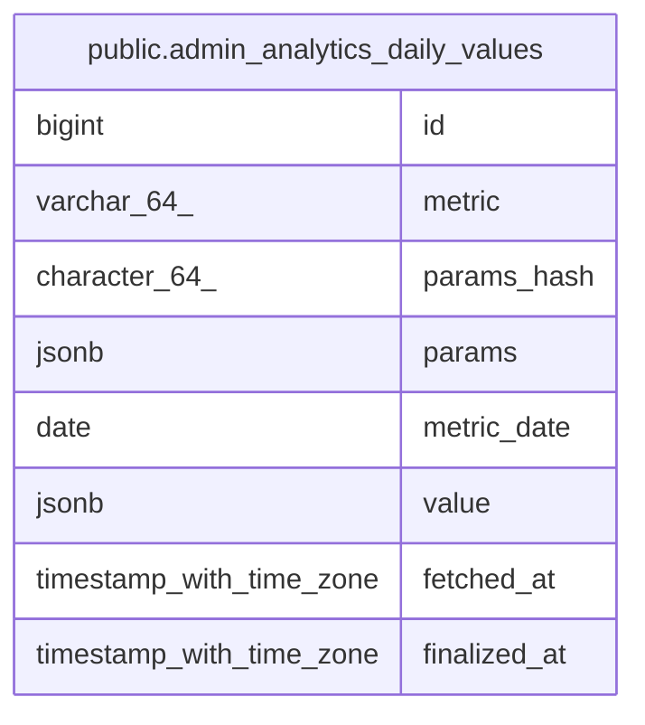

# public.admin_analytics_daily_values

## Columns

| Name | Type | Default | Nullable | Children | Parents | Comment |
| ---- | ---- | ------- | -------- | -------- | ------- | ------- |
| id | bigint | nextval('admin_analytics_daily_values_id_seq'::regclass) | false |  |  |  |
| metric | varchar(64) |  | false |  |  |  |
| params_hash | character(64) |  | false |  |  |  |
| params | jsonb |  | false |  |  |  |
| metric_date | date |  | false |  |  |  |
| value | jsonb |  | false |  |  |  |
| fetched_at | timestamp with time zone |  | false |  |  |  |
| finalized_at | timestamp with time zone |  | true |  |  |  |

## Constraints

| Name | Type | Definition |
| ---- | ---- | ---------- |
| admin_analytics_daily_values_pkey | PRIMARY KEY | PRIMARY KEY (id) |
| uk_admin_analytics_daily_values_key | UNIQUE | UNIQUE (metric, params_hash, metric_date) |

## Indexes

| Name | Definition |
| ---- | ---------- |
| admin_analytics_daily_values_pkey | CREATE UNIQUE INDEX admin_analytics_daily_values_pkey ON public.admin_analytics_daily_values USING btree (id) |
| uk_admin_analytics_daily_values_key | CREATE UNIQUE INDEX uk_admin_analytics_daily_values_key ON public.admin_analytics_daily_values USING btree (metric, params_hash, metric_date) |

## Relations

---

> Generated by [tbls](https://github.com/k1LoW/tbls)
