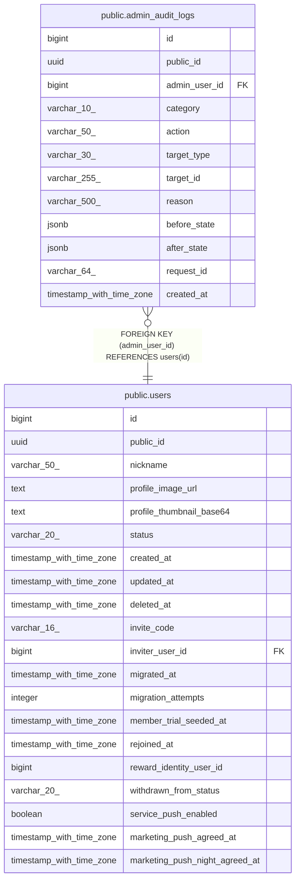

# public.admin_audit_logs

## Description

관리자 변경·개인정보 접속 기록. 영구 보존

## Columns

| Name | Type | Default | Nullable | Children | Parents | Comment |
| ---- | ---- | ------- | -------- | -------- | ------- | ------- |
| id | bigint |  | false |  |  |  |
| public_id | uuid |  | false |  |  |  |
| admin_user_id | bigint |  | false |  | [public.users](public.users.md) |  |
| category | varchar(10) |  | false |  |  |  |
| action | varchar(50) |  | false |  |  |  |
| target_type | varchar(30) |  | false |  |  |  |
| target_id | varchar(255) |  | false |  |  |  |
| reason | varchar(500) |  | true |  |  |  |
| before_state | jsonb |  | true |  |  |  |
| after_state | jsonb |  | true |  |  |  |
| request_id | varchar(64) |  | false |  |  |  |
| created_at | timestamp with time zone | now() | false |  |  |  |

## Constraints

| Name | Type | Definition |
| ---- | ---- | ---------- |
| admin_audit_logs_category_check | CHECK | CHECK (((category)::text = ANY ((ARRAY['CHANGE'::character varying, 'ACCESS'::character varying])::text[]))) |
| chk_admin_audit_reason | CHECK | CHECK (((((category)::text = 'CHANGE'::text) AND (reason IS NOT NULL) AND (length(btrim((reason)::text)) > 0)) OR (((category)::text = 'ACCESS'::text) AND (reason IS NULL)))) |
| admin_audit_logs_admin_user_id_fkey | FOREIGN KEY | FOREIGN KEY (admin_user_id) REFERENCES users(id) |
| admin_audit_logs_pkey | PRIMARY KEY | PRIMARY KEY (id) |
| admin_audit_logs_public_id_key | UNIQUE | UNIQUE (public_id) |

## Indexes

| Name | Definition |
| ---- | ---------- |
| admin_audit_logs_pkey | CREATE UNIQUE INDEX admin_audit_logs_pkey ON public.admin_audit_logs USING btree (id) |
| admin_audit_logs_public_id_key | CREATE UNIQUE INDEX admin_audit_logs_public_id_key ON public.admin_audit_logs USING btree (public_id) |
| idx_admin_audit_logs_created | CREATE INDEX idx_admin_audit_logs_created ON public.admin_audit_logs USING btree (created_at DESC, id DESC) |
| idx_admin_audit_logs_admin | CREATE INDEX idx_admin_audit_logs_admin ON public.admin_audit_logs USING btree (admin_user_id, created_at DESC) |
| idx_admin_audit_logs_target | CREATE INDEX idx_admin_audit_logs_target ON public.admin_audit_logs USING btree (target_type, target_id, created_at DESC) |

## Relations

---

> Generated by [tbls](https://github.com/k1LoW/tbls)
