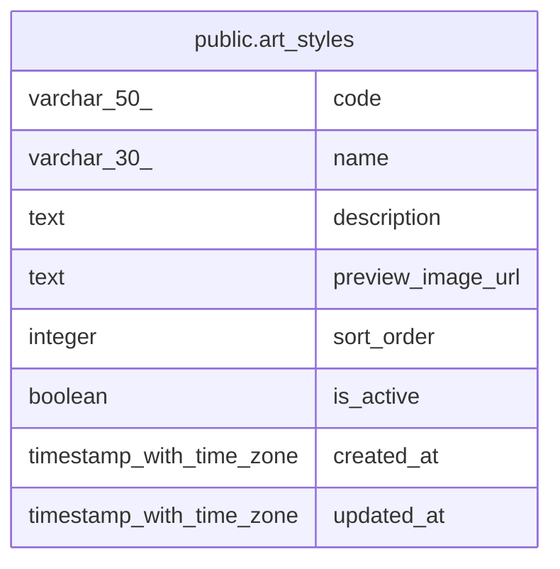

# public.art_styles

## Columns

| Name | Type | Default | Nullable | Children | Parents | Comment |
| ---- | ---- | ------- | -------- | -------- | ------- | ------- |
| code | varchar(50) |  | false |  |  |  |
| name | varchar(30) |  | false |  |  |  |
| description | text |  | false |  |  |  |
| preview_image_url | text |  | true |  |  |  |
| sort_order | integer |  | false |  |  |  |
| is_active | boolean | true | false |  |  |  |
| created_at | timestamp with time zone | now() | false |  |  |  |
| updated_at | timestamp with time zone | now() | false |  |  |  |

## Constraints

| Name | Type | Definition |
| ---- | ---- | ---------- |
| ck_art_styles_sort_order | CHECK | CHECK ((sort_order >= 1)) |
| art_styles_pkey | PRIMARY KEY | PRIMARY KEY (code) |

## Indexes

| Name | Definition |
| ---- | ---------- |
| art_styles_pkey | CREATE UNIQUE INDEX art_styles_pkey ON public.art_styles USING btree (code) |

## Relations

---

> Generated by [tbls](https://github.com/k1LoW/tbls)
