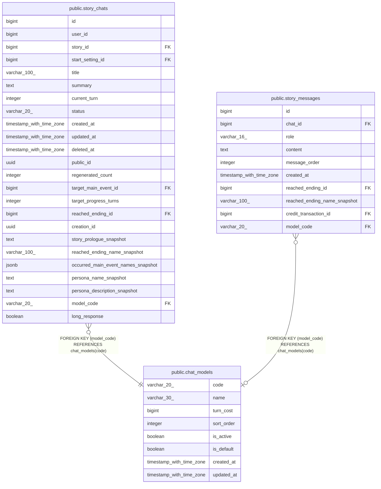

# public.chat_models

## Columns

| Name | Type | Default | Nullable | Children | Parents | Comment |
| ---- | ---- | ------- | -------- | -------- | ------- | ------- |
| code | varchar(20) |  | false | [public.story_chats](public.story_chats.md) [public.story_messages](public.story_messages.md) |  |  |
| name | varchar(30) |  | false |  |  |  |
| turn_cost | bigint |  | false |  |  |  |
| sort_order | integer |  | false |  |  |  |
| is_active | boolean | true | false |  |  |  |
| is_default | boolean | false | false |  |  |  |
| created_at | timestamp with time zone | now() | false |  |  |  |
| updated_at | timestamp with time zone | now() | false |  |  |  |

## Constraints

| Name | Type | Definition |
| ---- | ---- | ---------- |
| chat_models_check | CHECK | CHECK ((is_active OR (NOT is_default))) |
| chat_models_sort_order_check | CHECK | CHECK ((sort_order >= 1)) |
| chat_models_turn_cost_check | CHECK | CHECK (((turn_cost >= 1) AND (turn_cost <= 10000))) |
| chat_models_pkey | PRIMARY KEY | PRIMARY KEY (code) |

## Indexes

| Name | Definition |
| ---- | ---------- |
| chat_models_pkey | CREATE UNIQUE INDEX chat_models_pkey ON public.chat_models USING btree (code) |
| uq_chat_models_default | CREATE UNIQUE INDEX uq_chat_models_default ON public.chat_models USING btree (is_default) WHERE is_default |

## Relations

---

> Generated by [tbls](https://github.com/k1LoW/tbls)
