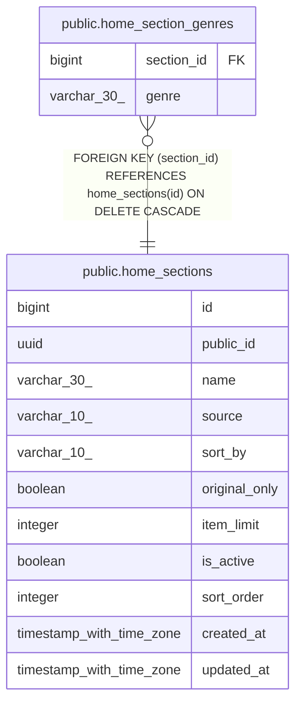

# public.home_section_genres

## Columns

| Name | Type | Default | Nullable | Children | Parents | Comment |
| ---- | ---- | ------- | -------- | -------- | ------- | ------- |
| section_id | bigint |  | false |  | [public.home_sections](public.home_sections.md) |  |
| genre | varchar(30) |  | false |  |  |  |

## Constraints

| Name | Type | Definition |
| ---- | ---- | ---------- |
| home_section_genres_section_id_fkey | FOREIGN KEY | FOREIGN KEY (section_id) REFERENCES home_sections(id) ON DELETE CASCADE |
| home_section_genres_pkey | PRIMARY KEY | PRIMARY KEY (section_id, genre) |

## Indexes

| Name | Definition |
| ---- | ---------- |
| home_section_genres_pkey | CREATE UNIQUE INDEX home_section_genres_pkey ON public.home_section_genres USING btree (section_id, genre) |

## Relations

---

> Generated by [tbls](https://github.com/k1LoW/tbls)
