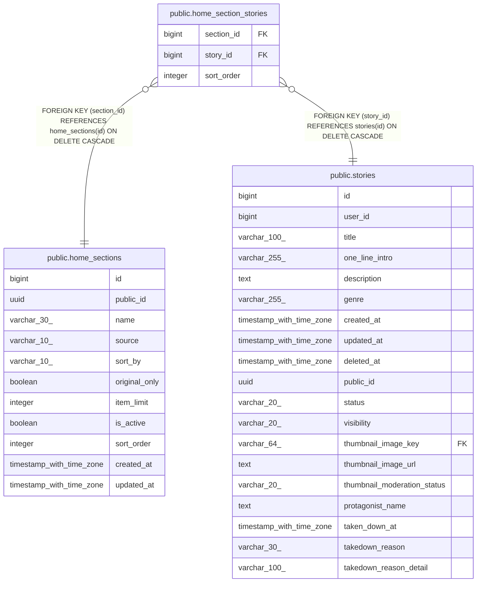

# public.home_section_stories

## Columns

| Name | Type | Default | Nullable | Children | Parents | Comment |
| ---- | ---- | ------- | -------- | -------- | ------- | ------- |
| section_id | bigint |  | false |  | [public.home_sections](public.home_sections.md) |  |
| story_id | bigint |  | false |  | [public.stories](public.stories.md) |  |
| sort_order | integer |  | false |  |  |  |

## Constraints

| Name | Type | Definition |
| ---- | ---- | ---------- |
| home_section_stories_sort_order_check | CHECK | CHECK ((sort_order >= 1)) |
| home_section_stories_story_id_fkey | FOREIGN KEY | FOREIGN KEY (story_id) REFERENCES stories(id) ON DELETE CASCADE |
| home_section_stories_section_id_fkey | FOREIGN KEY | FOREIGN KEY (section_id) REFERENCES home_sections(id) ON DELETE CASCADE |
| home_section_stories_pkey | PRIMARY KEY | PRIMARY KEY (section_id, story_id) |
| home_section_stories_section_id_sort_order_key | UNIQUE | UNIQUE (section_id, sort_order) |

## Indexes

| Name | Definition |
| ---- | ---------- |
| home_section_stories_pkey | CREATE UNIQUE INDEX home_section_stories_pkey ON public.home_section_stories USING btree (section_id, story_id) |
| home_section_stories_section_id_sort_order_key | CREATE UNIQUE INDEX home_section_stories_section_id_sort_order_key ON public.home_section_stories USING btree (section_id, sort_order) |

## Relations

---

> Generated by [tbls](https://github.com/k1LoW/tbls)
