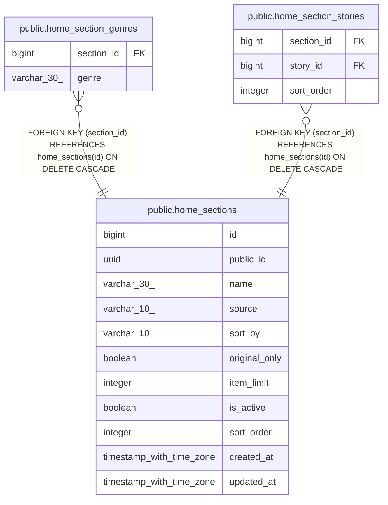

# public.home_sections

## Columns

| Name | Type | Default | Nullable | Children | Parents | Comment |
| ---- | ---- | ------- | -------- | -------- | ------- | ------- |
| id | bigint | nextval('home_sections_id_seq'::regclass) | false | [public.home_section_genres](public.home_section_genres.md) [public.home_section_stories](public.home_section_stories.md) |  |  |
| public_id | uuid | gen_random_uuid() | false |  |  |  |
| name | varchar(30) |  | false |  |  |  |
| source | varchar(10) |  | false |  |  |  |
| sort_by | varchar(10) |  | true |  |  |  |
| original_only | boolean | false | false |  |  |  |
| item_limit | integer | 20 | false |  |  |  |
| is_active | boolean | true | false |  |  |  |
| sort_order | integer |  | false |  |  |  |
| created_at | timestamp with time zone | now() | false |  |  |  |
| updated_at | timestamp with time zone | now() | false |  |  |  |

## Constraints

| Name | Type | Definition |
| ---- | ---- | ---------- |
| ck_home_sections_source_sort | CHECK | CHECK (((((source)::text = 'FILTER'::text) AND (sort_by IS NOT NULL)) OR (((source)::text = 'MANUAL'::text) AND (sort_by IS NULL)))) |
| home_sections_item_limit_check | CHECK | CHECK (((item_limit >= 1) AND (item_limit <= 20))) |
| home_sections_sort_by_check | CHECK | CHECK (((sort_by)::text = ANY ((ARRAY['POPULAR'::character varying, 'LATEST'::character varying, 'LIKES'::character varying, 'CHATS'::character varying])::text[]))) |
| home_sections_sort_order_check | CHECK | CHECK ((sort_order >= 1)) |
| home_sections_source_check | CHECK | CHECK (((source)::text = ANY ((ARRAY['MANUAL'::character varying, 'FILTER'::character varying])::text[]))) |
| home_sections_pkey | PRIMARY KEY | PRIMARY KEY (id) |
| home_sections_public_id_key | UNIQUE | UNIQUE (public_id) |

## Indexes

| Name | Definition |
| ---- | ---------- |
| home_sections_pkey | CREATE UNIQUE INDEX home_sections_pkey ON public.home_sections USING btree (id) |
| home_sections_public_id_key | CREATE UNIQUE INDEX home_sections_public_id_key ON public.home_sections USING btree (public_id) |
| idx_home_sections_active_order | CREATE INDEX idx_home_sections_active_order ON public.home_sections USING btree (is_active, sort_order, id) |

## Relations

---

> Generated by [tbls](https://github.com/k1LoW/tbls)
