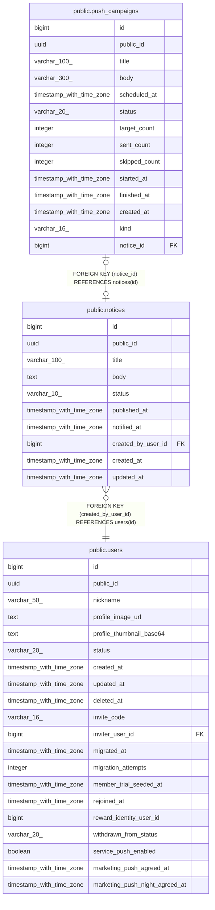

# public.notices

## Description

공지 초안과 게시. 알림 요청한 공지는 삭제하지 않는다

## Columns

| Name | Type | Default | Nullable | Children | Parents | Comment |
| ---- | ---- | ------- | -------- | -------- | ------- | ------- |
| id | bigint |  | false | [public.push_campaigns](public.push_campaigns.md) |  |  |
| public_id | uuid |  | false |  |  |  |
| title | varchar(100) |  | false |  |  |  |
| body | text |  | false |  |  |  |
| status | varchar(10) | 'DRAFT'::character varying | false |  |  |  |
| published_at | timestamp with time zone |  | true |  |  |  |
| notified_at | timestamp with time zone |  | true |  |  |  |
| created_by_user_id | bigint |  | false |  | [public.users](public.users.md) |  |
| created_at | timestamp with time zone | now() | false |  |  |  |
| updated_at | timestamp with time zone | now() | false |  |  |  |

## Constraints

| Name | Type | Definition |
| ---- | ---- | ---------- |
| ck_notices_published_at | CHECK | CHECK ((((status)::text <> 'PUBLISHED'::text) OR (published_at IS NOT NULL))) |
| notices_body_check | CHECK | CHECK ((((length(body) >= 1) AND (length(body) <= 5000)) AND (length(btrim(body)) > 0))) |
| notices_status_check | CHECK | CHECK (((status)::text = ANY ((ARRAY['DRAFT'::character varying, 'PUBLISHED'::character varying])::text[]))) |
| notices_title_check | CHECK | CHECK (((length(btrim((title)::text)) >= 1) AND (length(btrim((title)::text)) <= 100))) |
| notices_created_by_user_id_fkey | FOREIGN KEY | FOREIGN KEY (created_by_user_id) REFERENCES users(id) |
| notices_pkey | PRIMARY KEY | PRIMARY KEY (id) |
| notices_public_id_key | UNIQUE | UNIQUE (public_id) |

## Indexes

| Name | Definition |
| ---- | ---------- |
| notices_pkey | CREATE UNIQUE INDEX notices_pkey ON public.notices USING btree (id) |
| notices_public_id_key | CREATE UNIQUE INDEX notices_public_id_key ON public.notices USING btree (public_id) |
| idx_notices_published | CREATE INDEX idx_notices_published ON public.notices USING btree (published_at DESC, id DESC) WHERE ((status)::text = 'PUBLISHED'::text) |
| idx_notices_created | CREATE INDEX idx_notices_created ON public.notices USING btree (created_at DESC, id DESC) |

## Relations

---

> Generated by [tbls](https://github.com/k1LoW/tbls)
