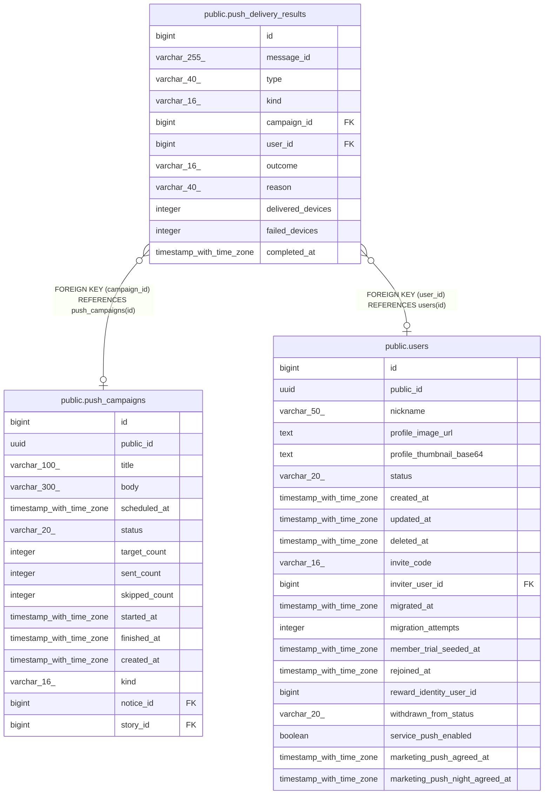

# public.push_delivery_results

## Columns

| Name | Type | Default | Nullable | Children | Parents | Comment |
| ---- | ---- | ------- | -------- | -------- | ------- | ------- |
| id | bigint |  | false |  |  |  |
| message_id | varchar(255) |  | false |  |  |  |
| type | varchar(40) |  | false |  |  |  |
| kind | varchar(16) |  | false |  |  |  |
| campaign_id | bigint |  | true |  | [public.push_campaigns](public.push_campaigns.md) |  |
| user_id | bigint |  | true |  | [public.users](public.users.md) |  |
| outcome | varchar(16) |  | false |  |  |  |
| reason | varchar(40) |  | false |  |  |  |
| delivered_devices | integer |  | false |  |  |  |
| failed_devices | integer |  | false |  |  |  |
| completed_at | timestamp with time zone |  | false |  |  |  |

## Constraints

| Name | Type | Definition |
| ---- | ---- | ---------- |
| push_delivery_results_delivered_devices_check | CHECK | CHECK ((delivered_devices >= 0)) |
| push_delivery_results_failed_devices_check | CHECK | CHECK ((failed_devices >= 0)) |
| push_delivery_results_kind_check | CHECK | CHECK (((kind)::text = ANY ((ARRAY['SERVICE'::character varying, 'MARKETING'::character varying])::text[]))) |
| push_delivery_results_outcome_check | CHECK | CHECK (((outcome)::text = ANY ((ARRAY['DELIVERED'::character varying, 'UNDELIVERED'::character varying, 'DISCARDED'::character varying])::text[]))) |
| push_delivery_results_user_id_fkey | FOREIGN KEY | FOREIGN KEY (user_id) REFERENCES users(id) |
| push_delivery_results_campaign_id_fkey | FOREIGN KEY | FOREIGN KEY (campaign_id) REFERENCES push_campaigns(id) |
| push_delivery_results_pkey | PRIMARY KEY | PRIMARY KEY (id) |
| push_delivery_results_message_id_key | UNIQUE | UNIQUE (message_id) |

## Indexes

| Name | Definition |
| ---- | ---------- |
| push_delivery_results_pkey | CREATE UNIQUE INDEX push_delivery_results_pkey ON public.push_delivery_results USING btree (id) |
| push_delivery_results_message_id_key | CREATE UNIQUE INDEX push_delivery_results_message_id_key ON public.push_delivery_results USING btree (message_id) |
| idx_push_delivery_results_campaign | CREATE INDEX idx_push_delivery_results_campaign ON public.push_delivery_results USING btree (campaign_id) WHERE (campaign_id IS NOT NULL) |
| idx_push_delivery_results_type_completed | CREATE INDEX idx_push_delivery_results_type_completed ON public.push_delivery_results USING btree (type, completed_at) |

## Relations

---

> Generated by [tbls](https://github.com/k1LoW/tbls)
