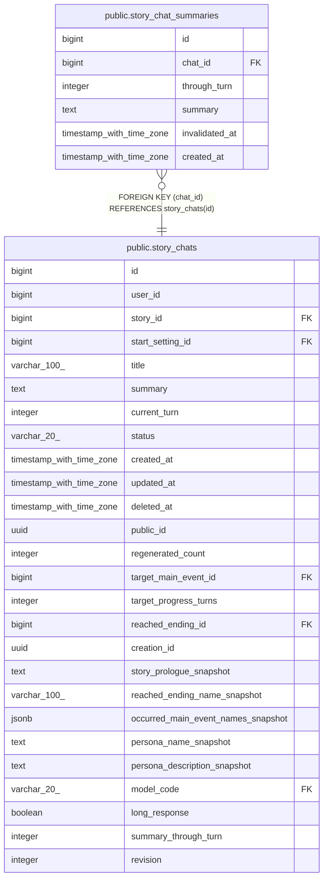

# public.story_chat_summaries

## Columns

| Name | Type | Default | Nullable | Children | Parents | Comment |
| ---- | ---- | ------- | -------- | -------- | ------- | ------- |
| id | bigint |  | false |  |  |  |
| chat_id | bigint |  | false |  | [public.story_chats](public.story_chats.md) |  |
| through_turn | integer |  | false |  |  |  |
| summary | text |  | false |  |  |  |
| invalidated_at | timestamp with time zone |  | true |  |  |  |
| created_at | timestamp with time zone | now() | false |  |  |  |

## Constraints

| Name | Type | Definition |
| ---- | ---- | ---------- |
| story_chat_summaries_through_turn_check | CHECK | CHECK ((through_turn >= 1)) |
| story_chat_summaries_chat_id_fkey | FOREIGN KEY | FOREIGN KEY (chat_id) REFERENCES story_chats(id) |
| story_chat_summaries_pkey | PRIMARY KEY | PRIMARY KEY (id) |

## Indexes

| Name | Definition |
| ---- | ---------- |
| story_chat_summaries_pkey | CREATE UNIQUE INDEX story_chat_summaries_pkey ON public.story_chat_summaries USING btree (id) |
| uq_story_chat_summaries_valid | CREATE UNIQUE INDEX uq_story_chat_summaries_valid ON public.story_chat_summaries USING btree (chat_id, through_turn) WHERE (invalidated_at IS NULL) |
| idx_story_chat_summaries_chat | CREATE INDEX idx_story_chat_summaries_chat ON public.story_chat_summaries USING btree (chat_id, through_turn DESC) |

## Relations

---

> Generated by [tbls](https://github.com/k1LoW/tbls)
