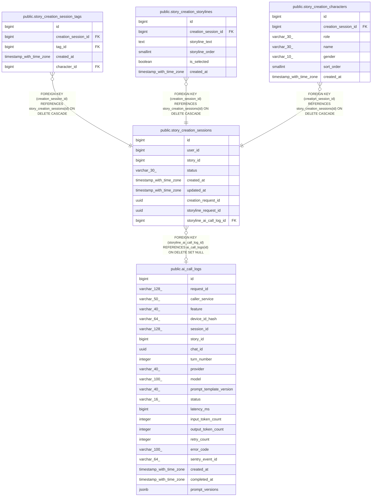

# public.story_creation_sessions

## Columns

| Name | Type | Default | Nullable | Children | Parents | Comment |
| ---- | ---- | ------- | -------- | -------- | ------- | ------- |
| id | bigint | nextval('story_creation_sessions_id_seq'::regclass) | false | [public.story_creation_session_tags](public.story_creation_session_tags.md) [public.story_creation_storylines](public.story_creation_storylines.md) [public.story_creation_characters](public.story_creation_characters.md) |  |  |
| user_id | bigint |  | true |  |  |  |
| story_id | bigint |  | true |  |  |  |
| status | varchar(30) |  | false |  |  |  |
| created_at | timestamp with time zone | now() | false |  |  |  |
| updated_at | timestamp with time zone | now() | false |  |  |  |
| creation_request_id | uuid |  | true |  |  | KNK-644: 완성(STORY_CREATED) 시점 요청의 request_id. 회수 재실행 검증용이며 storyline_request_id(스토리라인 단계)와 다른 값이다. |
| storyline_request_id | uuid |  | true |  |  | KNK-751: 스토리라인 생성(STORYLINE_GENERATION) 요청의 request_id. AI trace 여정을 묶는 creation_id로 헤더에 실린다. 이 컬럼 도입 전 세션은 NULL(헤더 생략). |
| storyline_ai_call_log_id | bigint |  | true |  | [public.ai_call_logs](public.ai_call_logs.md) | 이 세션을 생성한 스토리라인 AI 호출. 완성 시 해당 로그의 story_id를 연결하며 기존 세션은 NULL |

## Constraints

| Name | Type | Definition |
| ---- | ---- | ---------- |
| ck_story_creation_sessions_status | CHECK | CHECK (((status)::text = ANY ((ARRAY['STORYLINES_GENERATED'::character varying, 'STORY_CREATED'::character varying])::text[]))) |
| story_creation_sessions_pkey | PRIMARY KEY | PRIMARY KEY (id) |
| story_creation_sessions_storyline_ai_call_log_id_fkey | FOREIGN KEY | FOREIGN KEY (storyline_ai_call_log_id) REFERENCES ai_call_logs(id) ON DELETE SET NULL |

## Indexes

| Name | Definition |
| ---- | ---------- |
| story_creation_sessions_pkey | CREATE UNIQUE INDEX story_creation_sessions_pkey ON public.story_creation_sessions USING btree (id) |
| idx_story_creation_sessions_story | CREATE INDEX idx_story_creation_sessions_story ON public.story_creation_sessions USING btree (story_id) |
| idx_story_creation_sessions_storyline_request_id | CREATE INDEX idx_story_creation_sessions_storyline_request_id ON public.story_creation_sessions USING btree (storyline_request_id) |
| idx_creation_sessions_admin_created | CREATE INDEX idx_creation_sessions_admin_created ON public.story_creation_sessions USING btree (created_at, user_id) |

## Relations

---

> Generated by [tbls](https://github.com/k1LoW/tbls)
