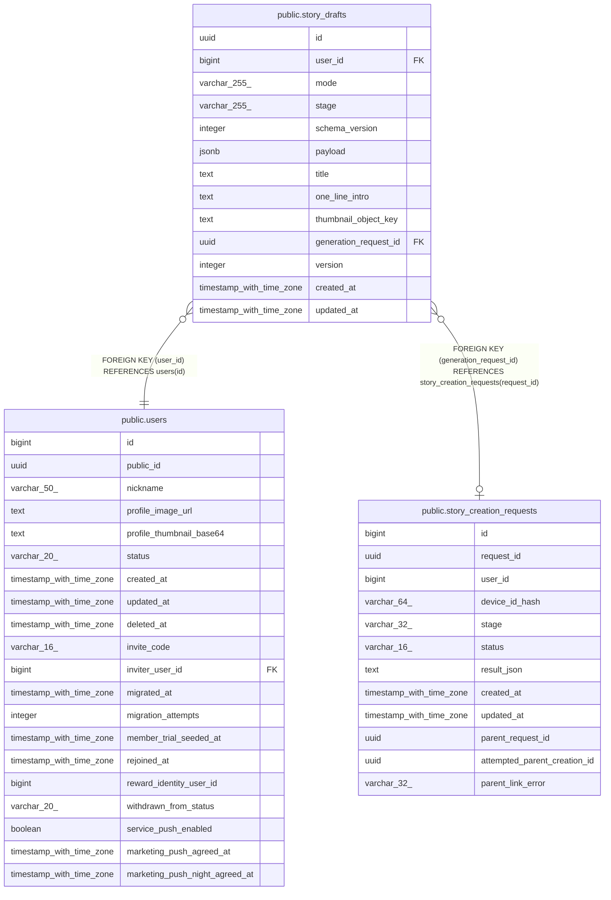

# public.story_drafts

## Columns

| Name | Type | Default | Nullable | Children | Parents | Comment |
| ---- | ---- | ------- | -------- | -------- | ------- | ------- |
| id | uuid |  | false |  |  |  |
| user_id | bigint |  | false |  | [public.users](public.users.md) |  |
| mode | varchar(255) |  | false |  |  |  |
| stage | varchar(255) |  | false |  |  |  |
| schema_version | integer |  | false |  |  |  |
| payload | jsonb |  | false |  |  |  |
| title | text |  | true |  |  |  |
| one_line_intro | text |  | true |  |  |  |
| thumbnail_object_key | text |  | true |  |  |  |
| generation_request_id | uuid |  | true |  | [public.story_creation_requests](public.story_creation_requests.md) |  |
| version | integer | 1 | false |  |  |  |
| created_at | timestamp with time zone | now() | false |  |  |  |
| updated_at | timestamp with time zone | now() | false |  |  |  |

## Constraints

| Name | Type | Definition |
| ---- | ---- | ---------- |
| ck_story_drafts_mode_stage | CHECK | CHECK (((((mode)::text = 'GENERAL'::text) AND ((stage)::text = 'GENERAL_DRAFT'::text)) OR (((mode)::text = 'SIMPLE'::text) AND ((stage)::text = ANY ((ARRAY['KEYWORD_DRAFT'::character varying, 'STORY_DRAFT'::character varying])::text[]))))) |
| ck_story_drafts_payload_object | CHECK | CHECK ((jsonb_typeof(payload) = 'object'::text)) |
| ck_story_drafts_version | CHECK | CHECK ((version >= 1)) |
| story_drafts_user_id_fkey | FOREIGN KEY | FOREIGN KEY (user_id) REFERENCES users(id) |
| story_drafts_generation_request_id_fkey | FOREIGN KEY | FOREIGN KEY (generation_request_id) REFERENCES story_creation_requests(request_id) |
| story_drafts_pkey | PRIMARY KEY | PRIMARY KEY (id) |

## Indexes

| Name | Definition |
| ---- | ---------- |
| story_drafts_pkey | CREATE UNIQUE INDEX story_drafts_pkey ON public.story_drafts USING btree (id) |
| ix_story_drafts_user_created | CREATE INDEX ix_story_drafts_user_created ON public.story_drafts USING btree (user_id, created_at DESC, id) |

## Relations

---

> Generated by [tbls](https://github.com/k1LoW/tbls)
