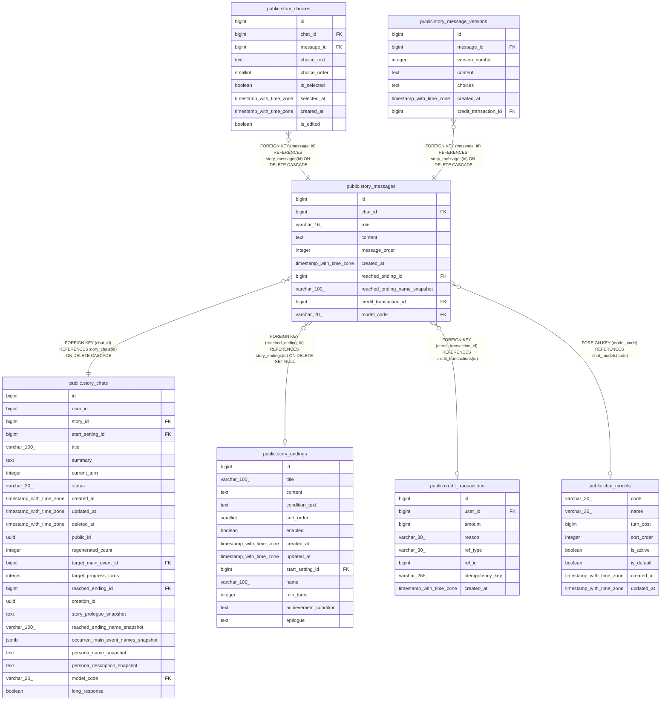

# public.story_messages

## Columns

| Name | Type | Default | Nullable | Children | Parents | Comment |
| ---- | ---- | ------- | -------- | -------- | ------- | ------- |
| id | bigint | nextval('story_messages_id_seq'::regclass) | false | [public.story_choices](public.story_choices.md) [public.story_message_versions](public.story_message_versions.md) |  |  |
| chat_id | bigint |  | false |  | [public.story_chats](public.story_chats.md) |  |
| role | varchar(16) |  | false |  |  |  |
| content | text |  | false |  |  |  |
| message_order | integer |  | false |  |  |  |
| created_at | timestamp with time zone | now() | false |  |  |  |
| reached_ending_id | bigint |  | true |  | [public.story_endings](public.story_endings.md) |  |
| reached_ending_name_snapshot | varchar(100) |  | true |  |  |  |
| credit_transaction_id | bigint |  | true |  | [public.credit_transactions](public.credit_transactions.md) |  |
| model_code | varchar(20) |  | true |  | [public.chat_models](public.chat_models.md) |  |

## Constraints

| Name | Type | Definition |
| ---- | ---- | ---------- |
| ck_story_messages_order | CHECK | CHECK ((message_order > 0)) |
| ck_story_messages_role | CHECK | CHECK (((role)::text = ANY ((ARRAY['USER'::character varying, 'ASSISTANT'::character varying, 'SYSTEM'::character varying])::text[]))) |
| story_messages_chat_id_fkey | FOREIGN KEY | FOREIGN KEY (chat_id) REFERENCES story_chats(id) ON DELETE CASCADE |
| story_messages_pkey | PRIMARY KEY | PRIMARY KEY (id) |
| fk_story_messages_reached_ending | FOREIGN KEY | FOREIGN KEY (reached_ending_id) REFERENCES story_endings(id) ON DELETE SET NULL |
| uq_story_messages_order | UNIQUE | UNIQUE (chat_id, message_order) |
| story_messages_credit_transaction_id_fkey | FOREIGN KEY | FOREIGN KEY (credit_transaction_id) REFERENCES credit_transactions(id) |
| story_messages_model_code_fkey | FOREIGN KEY | FOREIGN KEY (model_code) REFERENCES chat_models(code) |

## Indexes

| Name | Definition |
| ---- | ---------- |
| story_messages_pkey | CREATE UNIQUE INDEX story_messages_pkey ON public.story_messages USING btree (id) |
| uq_story_messages_order | CREATE UNIQUE INDEX uq_story_messages_order ON public.story_messages USING btree (chat_id, message_order) |
| idx_story_messages_admin_role_created_chat | CREATE INDEX idx_story_messages_admin_role_created_chat ON public.story_messages USING btree (role, created_at, chat_id) |
| idx_story_messages_admin_chat_role_created | CREATE INDEX idx_story_messages_admin_chat_role_created ON public.story_messages USING btree (chat_id, role, created_at) |
| uq_story_messages_credit_transaction | CREATE UNIQUE INDEX uq_story_messages_credit_transaction ON public.story_messages USING btree (credit_transaction_id) WHERE (credit_transaction_id IS NOT NULL) |

## Relations

---

> Generated by [tbls](https://github.com/k1LoW/tbls)
