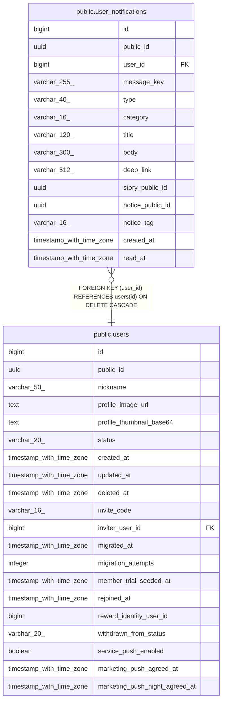

# public.user_notifications

## Columns

| Name | Type | Default | Nullable | Children | Parents | Comment |
| ---- | ---- | ------- | -------- | -------- | ------- | ------- |
| id | bigint |  | false |  |  |  |
| public_id | uuid |  | false |  |  |  |
| user_id | bigint |  | false |  | [public.users](public.users.md) |  |
| message_key | varchar(255) |  | false |  |  |  |
| type | varchar(40) |  | false |  |  |  |
| category | varchar(16) |  | false |  |  |  |
| title | varchar(120) |  | false |  |  |  |
| body | varchar(300) |  | false |  |  |  |
| deep_link | varchar(512) |  | true |  |  |  |
| story_public_id | uuid |  | true |  |  |  |
| notice_public_id | uuid |  | true |  |  |  |
| notice_tag | varchar(16) |  | true |  |  |  |
| created_at | timestamp with time zone | now() | false |  |  |  |
| read_at | timestamp with time zone |  | true |  |  |  |

## Constraints

| Name | Type | Definition |
| ---- | ---- | ---------- |
| user_notifications_category_check | CHECK | CHECK (((category)::text = ANY ((ARRAY['NEWS'::character varying, 'ACTIVITY'::character varying])::text[]))) |
| user_notifications_notice_tag_check | CHECK | CHECK (((notice_tag)::text = ANY ((ARRAY['SERVICE'::character varying, 'UPDATE'::character varying, 'MAINTENANCE'::character varying, 'EVENT'::character varying, 'PROMOTION'::character varying])::text[]))) |
| user_notifications_type_check | CHECK | CHECK (((type)::text = ANY ((ARRAY['STORY_COMPLETED'::character varying, 'STORY_MODERATION_COMPLETED'::character varying, 'STORY_TAKEN_DOWN'::character varying, 'NOTICE'::character varying, 'ATTENDANCE_REMINDER'::character varying, 'CREDIT_EXPIRY_REMINDER'::character varying, 'PROMOTION'::character varying])::text[]))) |
| user_notifications_user_id_fkey | FOREIGN KEY | FOREIGN KEY (user_id) REFERENCES users(id) ON DELETE CASCADE |
| user_notifications_pkey | PRIMARY KEY | PRIMARY KEY (id) |
| user_notifications_public_id_key | UNIQUE | UNIQUE (public_id) |
| uk_user_notifications_user_message | UNIQUE | UNIQUE (user_id, message_key) |

## Indexes

| Name | Definition |
| ---- | ---------- |
| user_notifications_pkey | CREATE UNIQUE INDEX user_notifications_pkey ON public.user_notifications USING btree (id) |
| user_notifications_public_id_key | CREATE UNIQUE INDEX user_notifications_public_id_key ON public.user_notifications USING btree (public_id) |
| uk_user_notifications_user_message | CREATE UNIQUE INDEX uk_user_notifications_user_message ON public.user_notifications USING btree (user_id, message_key) |
| idx_user_notifications_user_created | CREATE INDEX idx_user_notifications_user_created ON public.user_notifications USING btree (user_id, created_at DESC, id DESC) |
| idx_user_notifications_user_category_created | CREATE INDEX idx_user_notifications_user_category_created ON public.user_notifications USING btree (user_id, category, created_at DESC, id DESC) |
| idx_user_notifications_unread | CREATE INDEX idx_user_notifications_unread ON public.user_notifications USING btree (user_id, category) WHERE (read_at IS NULL) |

## Relations

---

> Generated by [tbls](https://github.com/k1LoW/tbls)
